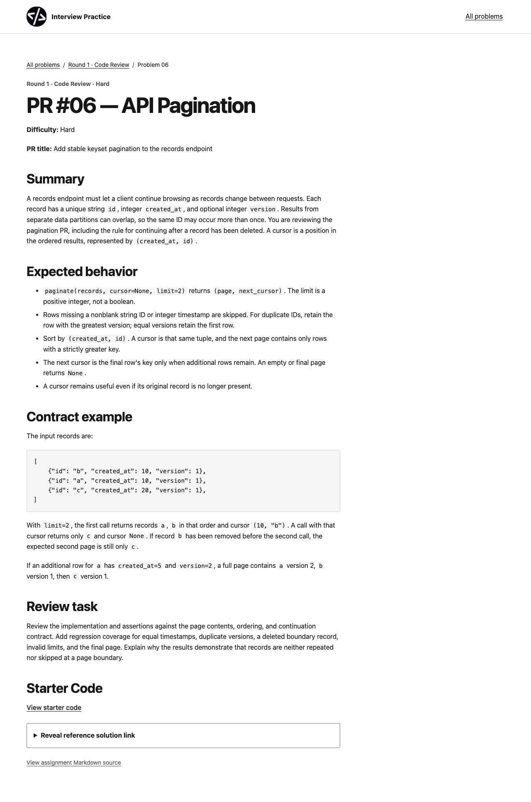
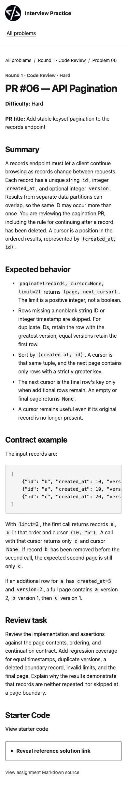
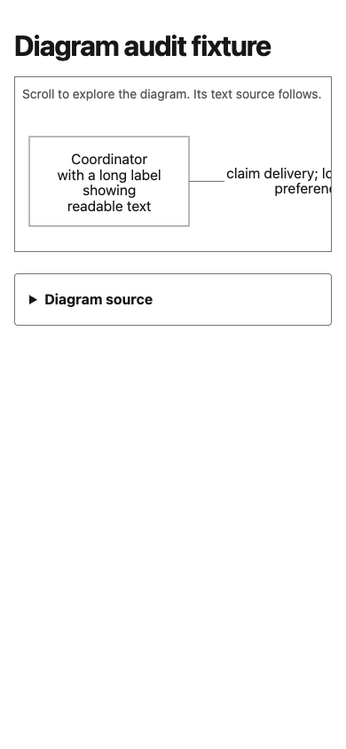

# Final site accessibility review

This review covers the generated catalog and all 65 problem pages after the
renderer changes for issue #17. Markdown remains the source of truth; generated
HTML is rebuilt with `scripts/build-site.py`.

## Results

- Chromium 155, axe-core 4.10.3: 132 page visits (catalog plus 65 problem pages
  at 1280 × 900 and 390 × 900). Zero axe violations or incomplete checks,
  horizontal document overflows, missing/broken images, heading-level jumps, or
  duplicate/missing main headings and landmarks.
- Keyboard: all 130 solution disclosures opened and closed with Space at both
  widths; the reference link was visible while open.
- Links and generated output: the CI site validator passed for the catalog,
  65 problem pages, local links/fragments/assets, and manifest resource paths.
  It also confirmed deterministic output from two clean builds.
- Mermaid renderer fixture: the exercise sources currently contain no Mermaid
  blocks, so a long-label flowchart was loaded through the site renderer as a
  browser fixture. At 390px, Mermaid produced an SVG inside a named, focusable
  region; its 846px content scrolls within a 356px viewport, with 16px text and
  no page-level horizontal overflow. Tab focus reached the diagram. The browser
  successfully loaded Mermaid 12.2.0 from jsDelivr in the final run; an earlier
  run saw one transient CDN 503.
- Contrast: the shared palette measures 17.93:1 for ink on paper, 7.81:1 for
  muted text on paper, 7.17:1 for muted text on the light surface, and 4.74:1
  for the strong border on paper. The Mermaid fixture uses ink on white and
  medium-gray edges. These calculated values do not replace user testing.

## Findings and changes

The first browser run found that generated pages had not yet been rebuilt after
the renderer changes; overflowing code blocks therefore lacked keyboard focus
and names. Rebuilding all 65 pages applied those attributes. The next run found
duplicate `region` names when a page had multiple code samples. Code samples
now use named, focusable `group` elements; table and Mermaid scroll containers
remain named regions. The final 132-visit browser run has zero axe violations.

The changes are limited to the renderer, its tests, shared diagram styles and
renderer copies, generated HTML, and QA evidence. No starter code, tests, or
reference solution files changed.

## Screenshots

The captures show the final generated page at desktop and mobile widths, plus
the mobile Mermaid overflow fixture.

## Limits

This was Chromium automation and visual inspection, not a screen-reader session
or a cross-browser review. The site validator checks local links, fragments,
images, and repository resource paths; it does not fetch external websites.
The Mermaid fixture depends on the configured jsDelivr CDN import. Production
pages presently contain no Mermaid diagrams, so the fixture checks renderer
behavior rather than a live assignment diagram.
