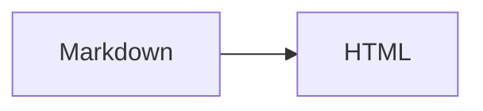
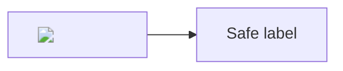
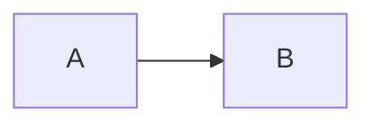

# Renderer fixture

**Strong**, *emphasis*, ~~removed~~ and `inline <code>`.

- First item
- Second item
  - Nested item

> A quoted paragraph.

| Input | Result |
| --- | --- |
| `<input>` | **Escaped** |

[Starter](../../round-1/01-code-validator/)
[Solution](../../solutions/round-1/01-code-validator/)
[Another problem](02-event-scheduler.md#expected-behavior)
[This section](#renderer-fixture)
[External](https://example.com/?one=1&two=2#part)

```python
if value < 10:
    print("<script> is text")
```

<script>window.fixtureExecuted = true</script>

[Unsafe](javascript:alert(1))
[Unsafe data](data:text/html;base64,PHNjcmlwdD4=)







```mermaid
this is not a valid diagram
```
