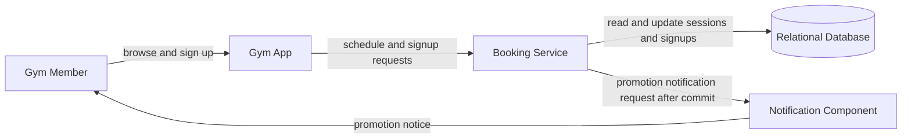
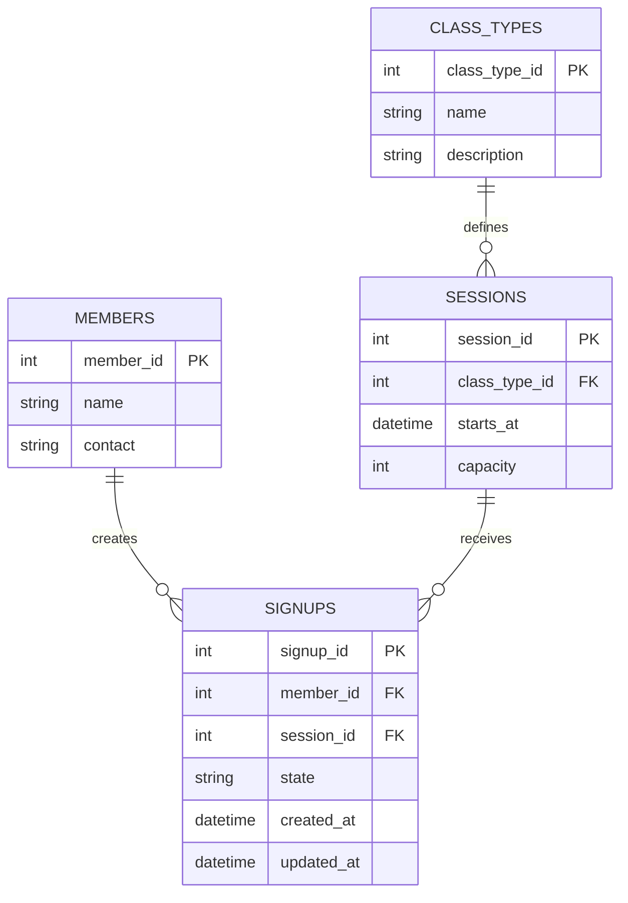

# Reference Solution — Gym Class Sign-Up

> These diagrams are reconstructed reference designs based only on the requirements supplied for this exercise; no local workshop slides or guide were available. This is one defensible design, not the only acceptable interview answer.

## 1. Clarify

Confirm whether capacity counts only confirmed signups, whether a signup can be changed between sessions, what “first come” means under simultaneous requests, and how late cancellations are treated. The supplied requirements say a cancellation promotes the first waitlisted member and that the promoted member is notified; this design makes promotion immediate and does not require the member to reconfirm. Clarify the gym's time zone and notification channel. Keep the initial system to one gym and a relational database.

The core invariants are: confirmed signups for a session never exceed its capacity; a member has at most one active signup for a session; waitlist order is stable; and cancelling one confirmed signup promotes at most one next member.

## 2. Interactions

Representative operations are `GET /sessions?week=...`, `POST /sessions/{session_id}/signups`, and `DELETE /signups/{signup_id}`. The member uses the gym app. The booking service owns validation and state changes; it is not a separate microservice per class type.

Registration reads the session, then in one database transaction either creates a confirmed signup if a place remains or creates a waitlisted signup. Cancellation marks the member's signup cancelled. If that signup was confirmed, the same transaction selects the earliest waiting signup and promotes it. After commit, the service asks the notification component to notify the promoted member.

## 3. Data Model

- `members(member_id PK, name, contact)` represents gym members.
- `class_types(class_type_id PK, name, description)` describes an offering such as yoga.
- `sessions(session_id PK, class_type_id FK, starts_at, capacity)` represents a dated class occurrence. Capacity is positive and refers to one session.
- `signups(signup_id PK, member_id FK, session_id FK, state, created_at, updated_at)` records a member's signup. States are `CONFIRMED`, `WAITLISTED`, and `CANCELLED`; promotion changes `WAITLISTED` to `CONFIRMED`.

Enforce at most one active signup for a member/session pair with a database uniqueness rule over active rows (or a normalized active-signup key). Use a stable waitlist ordering such as `(created_at, signup_id)`. The confirmed count must be changed under a transaction that serializes on the session row; a database constraint or equivalent transaction protocol must protect the capacity invariant. Cancelled records remain history but do not count toward capacity or waitlist position.

## 4. Architecture Diagram

The notification component is present because promoted members must be notified. The database remains the source of truth for capacity, signup state, and waitlist order.

## 5. Database ERD

## 6. Walkthrough

Suppose a session has capacity 12 and 12 confirmed signups. A new request enters the booking service. The service locks or otherwise serializes updates for that session, observes that confirmed capacity is full, writes a `WAITLISTED` signup with its committed timestamp, and commits. The app can now show the member their place according to the FIFO ordering.

When a confirmed member cancels, the service locks the session and signup, marks the signup `CANCELLED`, selects the first `WAITLISTED` row ordered by `(created_at, signup_id)`, and changes it to `CONFIRMED` in the same transaction. It commits both changes, then requests notification delivery. If notification delivery is delayed, the promoted member's confirmed state is still authoritative and visible in the app; delivery can be retried by the notification component.

## 7. Design Decisions

A relational database makes the member/session relationships, unique active signup rule, ordered waitlist, and transactional capacity changes explicit. A single booking service is enough for the stated one-gym scope. A separate notification component isolates delivery from booking state without making notifications responsible for promotion.

The waitlist is represented by signup state plus creation order rather than a separate queue. This keeps one record per member/session and makes cancelled or promoted entries auditable. For simultaneous requests, the database commit order (with signup ID as a stable tie-breaker) defines first come; a product requiring client-arrival ordering would need a different accepted timestamp policy.

## 8. Failure Cases & Trade-offs

- **Concurrent final-place requests:** Without serialization, both requests could observe a free place. Locking the session row or using a conditional capacity update in one transaction ensures only one becomes confirmed.
- **Cancellation and a new signup race:** Both operations serialize against the same session. The transaction ordering determines whether the new request takes the open place or a waiting member is promoted; every result must preserve the capacity and FIFO rules.
- **Notification outage:** Do not roll back an already committed promotion because email or push delivery failed. Retry delivery from a durable notification mechanism; do not promote the same waitlist entry twice.
- **Ambiguous “first come”:** Server receipt time and committed order can differ during contention. A simple committed-order rule is easy to explain and enforce, but the gym should define it.
- **Many sessions:** A single relational database remains appropriate. No message broker or cache is justified by the supplied scale.

## 9. Improvements

If the gym later requires reliable retry across process crashes, record a notification-outbox event in the same transaction as promotion and let a small worker deliver it. If member demand grows across many locations, introduce location and access-control rules only when those requirements arrive. If waitlist members must accept a promoted place, add an explicit offer state and offer expiry; that changes the stated immediate-promotion behavior and should be a product decision.
