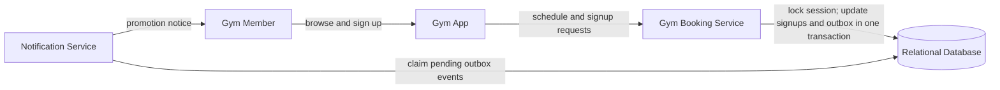
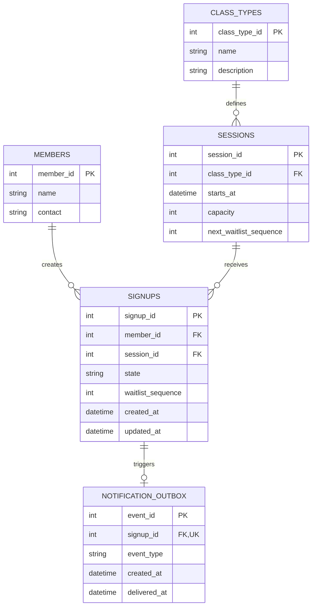

# Reference Solution — Gym Class Sign-Up

> Adapted from Noel's CIC workshop requirements. These editable Mermaid diagrams are reference-design adaptations, not exact reproductions of Noel's drawings. This is one defensible design, not the only acceptable interview answer.

## 1. Clarify

Capacity counts confirmed signups only. Members may cancel at any time; no cancellation deadline is imposed. “First come” is the order in which the booking service accepts requests while serializing changes to a session. A promoted member is confirmed immediately and notified; they do not need to reconfirm. Clarify the gym's time zone and notification channel. Keep the initial system to one gym and a relational database.

The core invariants are: confirmed signups for a session never exceed its capacity; a member has at most one active signup for a session; existing waitlisted members precede every later registration request; waitlist order is FIFO; and cancelling one confirmed signup promotes at most one next member.

## 2. Interactions

Representative operations are `GET /sessions?week=...`, `POST /sessions/{session_id}/signups`, and `DELETE /signups/{signup_id}`. The member uses the gym app. The booking service owns validation and state changes; it is not a separate microservice per class type.

Every signup or cancellation first locks the session row. In that transaction, registration checks for an existing active signup and counts confirmed signups. Before serving the new request, it fills every available place from the existing FIFO queue, promoting the oldest waiter first each time. It then confirms the new request only if both capacity and the queue allow it; otherwise the request joins the tail. A per-session sequence allocated under the same lock defines queue order. Cancelling a confirmed signup and promoting the oldest waiter happen atomically; cancelling a waitlisted signup only changes its state. The transaction also inserts a notification-outbox record for each promotion, which the notification service delivers after commit.

## 3. Data Model

- `members(member_id PK, name, contact)` represents gym members.
- `class_types(class_type_id PK, name, description)` describes an offering such as yoga.
- `sessions(session_id PK, class_type_id FK, starts_at, capacity, next_waitlist_sequence)` represents a dated class occurrence. Capacity is positive and refers to one session. The sequence counter is incremented only while holding the session lock.
- `signups(signup_id PK, member_id FK, session_id FK, state, waitlist_sequence nullable, created_at, updated_at)` records a member's signup. States are `confirmed`, `waitlisted`, and `cancelled`; promotion changes `waitlisted` to `confirmed`. The session-local sequence is assigned only to a waitlisted signup while holding the session lock.
- `notification_outbox(event_id PK, signup_id FK UNIQUE, event_type, created_at, delivered_at nullable)` records each waitlist promotion that needs a notification. It is inserted in the same transaction as the state change so a process failure cannot lose the notification request; a signup can be promoted only once.

Enforce at most one active signup for a member/session pair with a database uniqueness rule over active rows (or a normalized active-signup key). Order waitlisted rows by their unique session-local `waitlist_sequence`; assign it while holding the session lock so timestamp precision cannot reorder simultaneous requests. The confirmed count must be read and changed under a transaction that serializes on the session row. Cancelled records remain history but do not count toward capacity or the active waitlist.

Also enforce `UNIQUE(session_id, waitlist_sequence)` for non-null waitlist sequence values. This prevents two waitlisted signups from receiving the same FIFO position.

## 4. Architecture Diagram

The notification service reads committed outbox events and delivers the required promotion notices. The relational database remains the source of truth for capacity, signup state, and waitlist order.

## 5. Database ERD

## 6. Walkthrough

Suppose a session has capacity 12 and 12 confirmed signups. A new request enters the booking service. The service locks the session, observes that confirmed capacity is full, allocates the next session-local sequence, writes a `waitlisted` signup, and commits. The app can now show the member their place according to the FIFO ordering.

When a confirmed member cancels at any time, the service locks the session, marks that signup `cancelled`, selects the smallest active `waitlist_sequence`, changes that signup to `confirmed`, and inserts its outbox event in the same transaction. If a capacity change or prior recovery left more free places, it continues promoting in FIFO order until either capacity is filled or no waiters remain. Capacity and queue state therefore change atomically. If a new registration races with this cancellation, both wait for the same session lock: whichever transaction runs first cannot bypass a waiter, and the cancellation transaction promotes the existing FIFO head before commit. A notification worker can retry an undelivered outbox event without repeating the promotion.

## 7. Design Decisions

A relational database makes the member/session relationships, unique active signup rule, ordered waitlist, and transactional capacity changes explicit. A single booking service is enough for the stated one-gym scope. The notification service handles delivery but does not decide promotion or queue order.

The waitlist is represented by signup state plus a session-local monotonic sequence rather than a separate queue. The session lock serializes both sequence allocation and seat decisions. Existing waiters are never bypassed by a new request, including if a capacity change or recovery leaves several free seats beside a nonempty queue: promote as many waiters as fit before considering the new request. Cancelled rows remain auditable but no longer occupy queue priority.

## 8. Failure Cases & Trade-offs

- **Concurrent final-place requests:** Without serialization, both requests could observe a free place. Locking the session row or using a conditional capacity update in one transaction ensures only one becomes confirmed.
- **Cancellation and a new signup race:** Both operations serialize against the same session. The cancellation promotes the current FIFO head in its transaction; the later registration sees the resulting capacity and queue and cannot jump ahead.
- **Notification outage:** The promotion and outbox row commit together. A retrying notification service sends the event without changing signup state or promoting the same waitlisted member twice. Use the outbox event ID as a delivery idempotency key where supported; otherwise an ambiguous provider timeout can produce a duplicate notice even though the signup transition remains exactly once.
- **Ambiguous “first come”:** Requests may arrive in one order but acquire the session lock in another. This design defines first come as the order accepted under that lock; if the gym instead requires receipt-time ordering, it must capture and enforce that ordering explicitly.
- **Many sessions:** A single relational database remains appropriate. No message broker or cache is justified by the supplied scale.

## 9. Improvements

If member demand grows across many locations, introduce location and access-control rules only when those requirements arrive. If waitlist members must accept a promoted place, add an explicit offer state and offer expiry; that changes the stated immediate-promotion behavior and should be a product decision.
