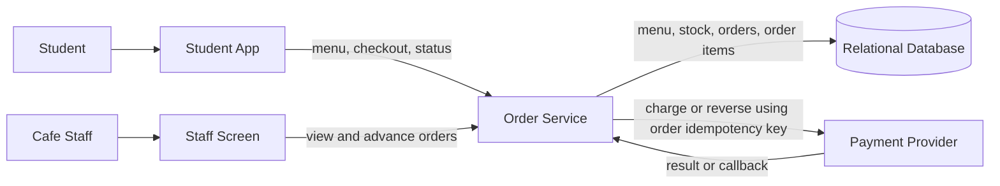
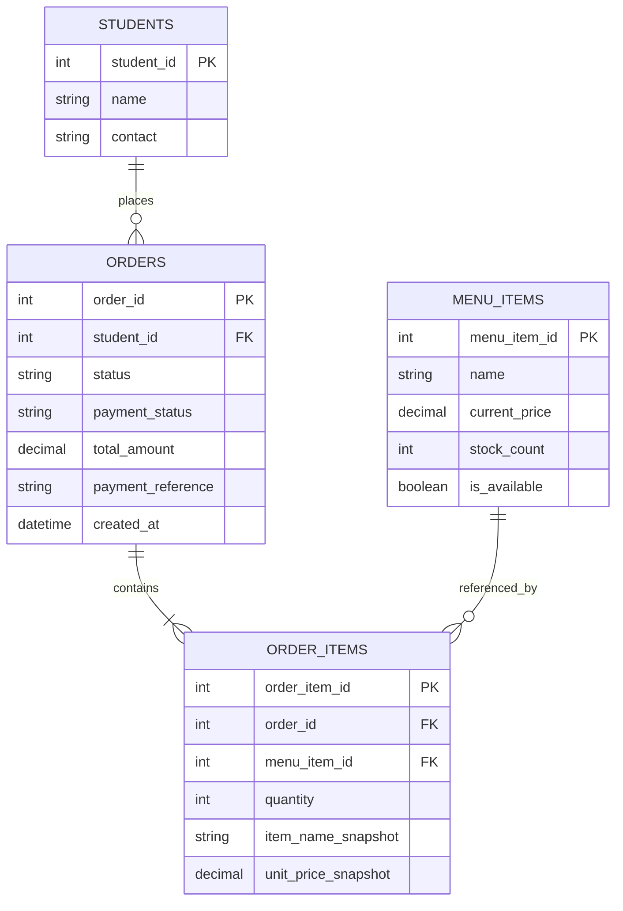

# Reference Solution — Campus Café Mobile Ordering

> Adapted from Noel's CIC workshop requirements. These editable Mermaid diagrams are reference-design adaptations, not exact reproductions of Noel's drawings. This is one defensible design, not the only acceptable interview answer.

## 1. Clarify

The customer-facing order lifecycle is `PLACED → PREPARING → READY → PICKED_UP`, with `CANCELLED` as a separate terminal state. `PENDING_PAYMENT` is an internal pre-placement state, not part of that customer-facing progression. Keep payment state separate. Clarify how long checkout may remain pending and how a pre-preparation cancellation is reversed. The brief specifies one café and sellable stock counts but no update mechanism, so the initial design can use polling.

Keep payment credentials with the provider. The core invariants are: an order item uses the price captured at purchase time; available stock never drops below zero; a provider retry does not create duplicate charges; and customer-facing order progress cannot move backward or proceed after cancellation.

## 2. Interactions

Representative operations are `GET /menu`, `POST /orders`, `GET /orders/{id}`, and staff-only `GET /staff/orders` / `PATCH /staff/orders/{id}/status`. The order service is the shared application boundary for the student app and staff screen. The payment provider is external.

For checkout, the service validates item IDs and quantities, then transactionally creates an internal `PENDING_PAYMENT` order and order-item snapshots while reserving/decrementing the requested stock. It calls the provider using the order ID as an idempotency key. On confirmed payment, it records payment success and moves the order to `PLACED`, making it visible to staff. On a definite failure or expiry, it marks payment failed, moves the order to terminal `CANCELLED`, and restores stock once. A timeout remains pending until a provider lookup or callback resolves it; blindly charging again is unsafe. Customers can see a payment-pending response while the customer-facing order lifecycle has not started.

Staff transitions are checked by the order service against `PLACED → PREPARING → READY → PICKED_UP`. A cancellation request is accepted only before preparation; the service changes the order to `CANCELLED`, releases stock exactly once, and requests a void/refund as applicable. The café must decide how to show a reversal that is still pending.

## 3. Data Model

- `students(student_id PK, name, contact)` identifies students.
- `menu_items(menu_item_id PK, name, current_price, stock_count, is_available)` stores the current café menu and sellable portion count. `is_available` is the café's menu-enable flag; `stock_count == 0` independently means sold out, so the flag cannot make an empty item orderable.
- `orders(order_id PK, student_id FK, status, payment_status, total_amount, created_at, payment_reference)` stores the order workflow. `PENDING_PAYMENT` is internal and precedes placement; after payment success, the customer-facing order states progress `PLACED → PREPARING → READY → PICKED_UP`. `CANCELLED` is terminal and separate from that progression. Payment state is tracked separately as pending/succeeded/failed/void-pending/refunded.
- `order_items(order_item_id PK, order_id FK, menu_item_id FK, quantity, item_name_snapshot, unit_price_snapshot)` records what the student ordered at the charged price.

The order item references a menu item for traceability but stores a snapshot so later menu edits do not rewrite history. Validate positive quantities and nonnegative prices. Stock decrement must be conditional/transactional and cancellation or payment failure must restore it at most once. Provider idempotency uses the stable order ID; provider reference is stored after a result is known. Staff see only paid orders, and status updates follow the stated progression.

## 4. Architecture Diagram

One service handles both student and staff requests so both observe the same order state and transition rules. The payment provider is shown separately because it owns payment processing.

## 5. Database ERD

The one-or-more relationship from order to order item applies to a submitted order; a short-lived draft checkout may be represented before submission if the implementation needs it. The menu item reference may become nullable or point to retained catalog history if items can be deleted; deletion policy should preserve order history.

## 6. Walkthrough

A student selects two sandwiches. The order service checks that the IDs are valid, the items are sellable, and stock is sufficient. In one database transaction it locks or conditionally updates the stock rows, stores an order with internal status `PENDING_PAYMENT`, stores item names and unit-price snapshots, calculates the total using decimal currency arithmetic, and commits the reservation. It then asks the provider to charge with `order_id` as the idempotency key. On confirmed payment, a transaction records payment success and moves the order to `PLACED`, making it visible in the staff queue. On definitive payment failure or expiry, it marks the order `CANCELLED` and releases reserved stock once. Customers may see a payment-pending message while the customer-facing order status has not begun.

When payment success arrives, the service records the provider reference and changes the order to `PLACED`. The staff screen reads that state. A staff update to `PREPARING` is accepted only from `PLACED`, `READY` only from `PREPARING`, and `PICKED_UP` only from `READY`. A student polling the status endpoint sees the committed state. If payment fails, the service records that outcome, moves the internal order to terminal `CANCELLED`, and releases the reserved stock exactly once.

## 7. Design Decisions

The four relational entities preserve the workshop's supplied data model: students, menu items, orders, and order items. Price snapshots are essential because current menu prices change. The payment provider remains an external dependency and no card number is stored. A single order service supports both the mobile and staff workflows; it can enforce authorization for staff-only operations.

Keeping order state and payment state separate avoids conflating a kitchen transition with a provider result. `PENDING_PAYMENT` is only an internal pre-placement state; the original customer-facing lifecycle starts at `PLACED` and ends at `PICKED_UP` or terminal `CANCELLED`. Staff updates are validated against the forward-only transition table. For modest one-café use, a relational database and polling are easier to reason about than a message bus or real-time push system.

## 8. Failure Cases & Trade-offs

- **Concurrent last-item checkout:** A read-then-write stock check is racy. Use row locking or an atomic conditional decrement and abort the entire checkout if any item cannot be reserved.
- **Provider timeout:** The charge may have succeeded even if the service did not receive the response. Keep the order pending and reconcile by idempotency key/provider reference; do not issue a new charge with a new key.
- **Failure after stock reservation:** Persist enough state to release a reservation exactly once when payment definitively fails or expires. A recovery process may reconcile stuck pending orders.
- **Cancellation after payment:** The café's stated cancellation boundary is before preparation. A void/refund can fail or remain pending, so show payment reversal status separately and define the customer-support policy.
- **Payment success races with cancellation:** Both handlers lock the order row. If cancellation wins, a later success is recorded and voided/refunded without reopening the order or restoring stock twice. If payment success wins first, a valid pre-preparation cancellation moves the order to `CANCELLED` and begins reversal.
- **Invalid staff transition:** Reject it without changing order state; retain authorization checks so students cannot call staff operations.
- **Polling load:** Polling is appropriate absent a freshness target. Add push updates only if observed delay or traffic makes it necessary.

## 9. Improvements

If failures between database commit and provider call need automatic recovery, add a durable payment-request/outbox record and a worker that retries with the same provider idempotency key. Add an audit trail for staff transitions if the café needs accountability. Add a second location only when required, then scope menu and inventory by location. None of these additions is needed to make the first single-café design correct.
