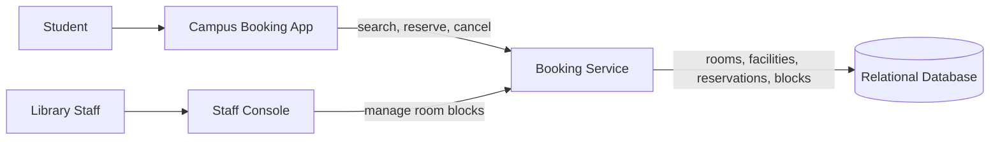
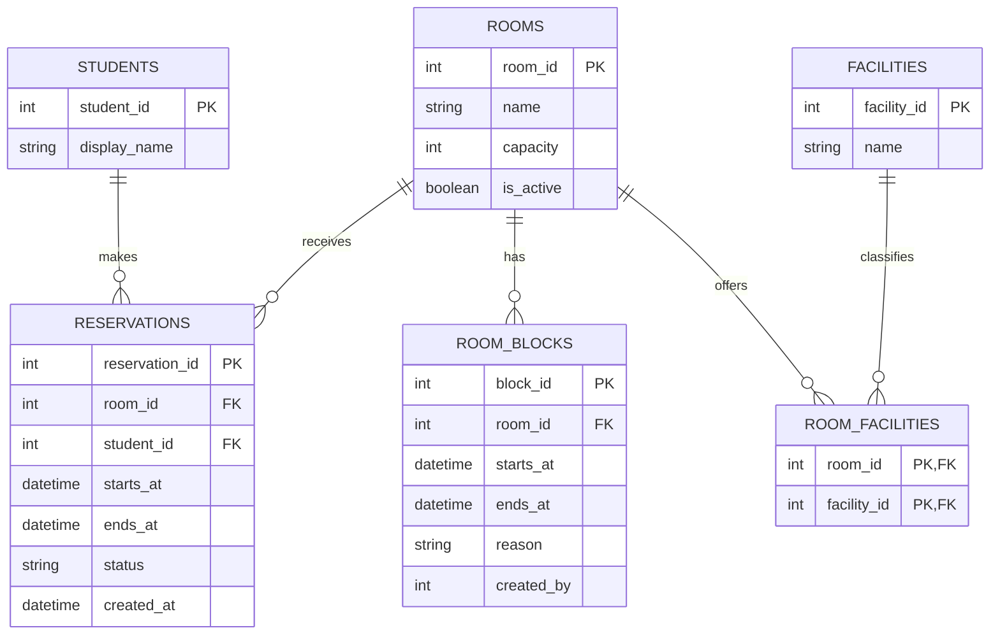

# Reference Solution — Student Study Room Booking

## 1. Clarify

Ask whether bookings are fixed slots or arbitrary intervals, how far ahead and how long students may book, whether students can reserve multiple rooms, and whether staff maintenance overrides confirmed bookings. The brief uses explicit intervals, allows adjacent bookings, and requires staff blocks to prevent new reservations. For a small first release, use one campus, authenticated students, a relational database, and a basic room search.

Important invariants: active reservations for the same room cannot overlap; a cancelled reservation no longer blocks time; only the owner or authorized staff can cancel; and a maintenance block prevents a new overlapping confirmation.

## 2. Interactions

Possible endpoints include `GET /rooms?start=...&end=...&capacity=...&facilities=...`, `POST /reservations`, `GET /me/reservations`, and `DELETE /reservations/{id}`. Staff use `POST /room-blocks` and `DELETE /room-blocks/{id}`. The availability search is a candidate finder, not a promise.

Reservation creation and staff block creation/removal all serialize on the same room row. The service validates interval bounds, begins a transaction, checks for overlapping confirmed reservations and staff blocks, and inserts a confirmed reservation only if none conflict. A room block is likewise rejected or handled under an explicit override policy if it overlaps a confirmed reservation. It commits and returns the result; otherwise it returns a conflict and asks the client to refresh availability.

## 3. Data Model

- `students(student_id PK, display_name)` identifies bookers.
- `rooms(room_id PK, name, capacity, is_active)` describes reservable rooms.
- `facilities(facility_id PK, name)` catalogs filterable room features.
- `room_facilities(room_id FK, facility_id FK)` is a many-to-many join with composite primary key.
- `reservations(reservation_id PK, room_id FK, student_id FK, starts_at, ends_at, status, created_at)` records a time interval and owner. `ends_at` must be later than `starts_at`; status is `CONFIRMED` or `CANCELLED`.
- `room_blocks(block_id PK, room_id FK, starts_at, ends_at, reason, created_by)` records staff maintenance/unavailability intervals.

An overlap exists when `existing.starts_at < requested.ends_at` and `requested.starts_at < existing.ends_at`; strict inequalities allow adjacent reservations. Enforce this in a transaction that serializes on the room or with a database-native exclusion constraint if available. A plain application-level query without transaction isolation is insufficient.

## 4. Architecture Diagram

The same service checks both student reservations and staff blocks against the same persistent room state. No separate search index is needed for the initial campus-sized catalog.

## 5. Database ERD

`created_by` refers to the campus staff identity; if staff accounts are managed in this system, model that identity as a separate entity and foreign key. It is shown as an identifier here to avoid inventing a staff administration subsystem.

## 6. Walkthrough

A student searches for a room for 2:00–3:00 PM with at least six seats and a whiteboard. The service filters active rooms by capacity and facility joins, then excludes rooms with any overlapping confirmed reservation or room block. The app displays candidate rooms with an availability timestamp/notice that a result can change.

The student chooses one room. The service begins a transaction, locks that room row (or uses an equivalent serializable strategy shared with staff-block writes), repeats the overlap checks, inserts the confirmed reservation, and commits. If a concurrent reservation or maintenance block already won, the second conflicting write is rejected rather than double-booking or blocking an existing reservation silently.

## 7. Design Decisions

A relational model fits the relationships and makes foreign keys and ownership clear. Facilities use a join table because one room has many facilities and a facility appears in many rooms. Reservations and staff blocks share interval semantics but remain separate records because different actors create and cancel them.

Serializing per room is simple and adequate for campus scale. It may reduce simultaneous booking throughput for one especially popular room, but operations are short and room-level contention is the exact resource being protected. Availability can be calculated on demand; a cache would risk showing stale results and cannot confirm a booking.

## 8. Failure Cases & Trade-offs

- **Two overlapping reservations race:** Search both results as available, but transaction-time checks and room-level serialization allow only one confirmation.
- **Adjacent intervals:** Strict overlap comparisons let a 3:00 PM booking follow one ending at 3:00 PM. Inclusive comparisons would incorrectly block it.
- **Maintenance added over a reservation:** The system needs a staff policy: reject the block, require explicit override/rebooking, or notify affected students. Do not silently erase a confirmed reservation.
- **Client retries after timeout:** A repeated reservation submission could create duplicates. Accept an idempotency token or enforce a client request key if retries are expected; explain what result the same key returns.
- **Time-zone/DST errors:** Store unambiguous instants and render campus-local time. Validate that intervals remain positive after conversion.

## 9. Improvements

Recurring bookings could be represented by a series plus generated occurrences, but each actual occurrence still needs the same conflict invariant. If catalog search becomes large, introduce a search index only for discovery; always revalidate against the relational source of truth at booking time. If multiple campuses are added, include campus identity in rooms and authorization rules before exposing cross-campus search.
