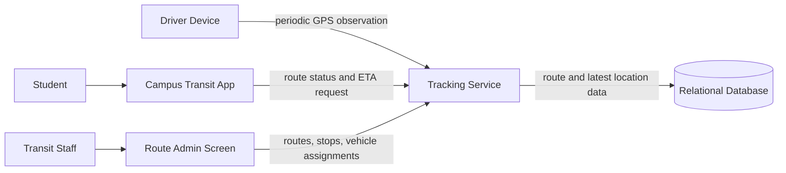
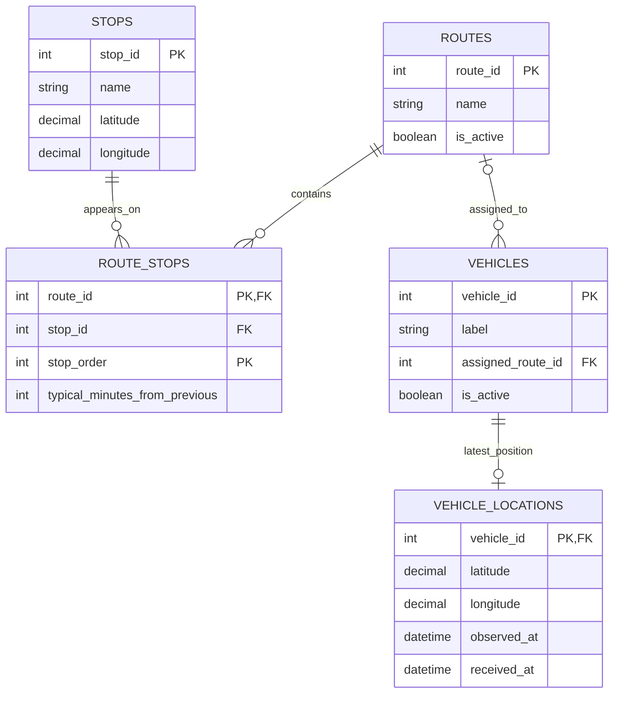

# Reference Solution — Campus Shuttle Live Tracking

## 1. Clarify

Ask how frequently the driver device can report, what freshness users need, whether routes have scheduled travel-time data, whether the ETA is expected to include traffic, and whether old points are needed for trip replay. The initial design assumes updates roughly every 10–30 seconds, one campus, route stop order and configured typical segment times, and no trip history requirement. GPS-derived ETAs are estimates, not guarantees.

Invariants: a vehicle is associated with a current route assignment; the displayed point is the newest valid observation for that vehicle; and an observation older than the freshness threshold is labeled stale rather than presented as live.

## 2. Interactions

The driver device sends `POST /vehicles/{id}/locations` with coordinates and observation time. Students use `GET /routes` and `GET /routes/{id}/status` for ordered stops, assigned vehicles, latest locations, freshness, and estimates. Transit staff manage routes and assignments through authenticated operations.

The tracking service validates the vehicle and coordinate range, compares the observation timestamp with the stored latest point, and updates the current-location record only if it is newer. On lookup it loads route stops, segment estimates, and current vehicle position, calculates upcoming stop ETAs, and marks the result stale or unavailable if its age exceeds the configured threshold.

## 3. Data Model

- `routes(route_id PK, name, is_active)` describes a shuttle route.
- `stops(stop_id PK, name, latitude, longitude)` stores campus stops.
- `route_stops(route_id FK, stop_id FK, stop_order, typical_minutes_from_previous)` defines the ordered route; `(route_id, stop_order)` is unique.
- `vehicles(vehicle_id PK, label, assigned_route_id FK nullable, is_active)` describes shuttles and current assignment.
- `vehicle_locations(vehicle_id PK/FK, latitude, longitude, observed_at, received_at)` stores the latest accepted point for each vehicle. `observed_at` is device time; `received_at` supports diagnostics.

Only the latest location is needed for this initial user-facing behavior. A stale update does not replace a newer point. Use server time for `received_at` and validate acceptable timestamp skew, since device clocks can be wrong. Route ETAs can be an estimate using the last known position/segment and configured segment durations; disclose the approximation.

## 4. Architecture Diagram

The tracking service handles ingestion and student reads; its responsibilities differ by operation but share route and location state. The data store remains the source of truth. Push infrastructure is not necessary for the initial polling design.

## 5. Database ERD

`ROUTES o|--o{ VEHICLES` means a vehicle may be unassigned or assigned to one route, while a route may have multiple vehicles. `VEHICLES ||--o| VEHICLE_LOCATIONS` permits a vehicle to have no reported point yet, or exactly one latest point.

## 6. Walkthrough

A driver device submits a coordinate observed at 10:02:12. The service verifies the device's vehicle, coordinate bounds, and timestamp. If the stored point is from 10:02:05, it replaces the latest point and records server receipt time. A student asks for that route's status. The service reads its ordered stops and assigned vehicles, computes approximate arrival times from route configuration and last known progress, and compares the point age with the freshness threshold. It returns the estimate with “updated 8 seconds ago.”

If the device later reconnects and submits a point observed at 10:01:58, it is older than the stored point and is rejected for current-state update. The API can acknowledge it as ignored without moving the marker backwards.

## 7. Design Decisions

Storing one current location per vehicle keeps reads straightforward and avoids retaining a large stream of coordinates that the brief does not require. Separating `observed_at` from `received_at` exposes network delay and helps identify bad device clocks. Relational route-stop ordering is useful because route topology is small and changes need clear ordering.

ETAs based on typical segment times are intentionally approximate. A map-matching engine or traffic provider would add complexity and external dependencies. For initial use, a student-facing timestamp and stale indicator may be more valuable than pretending an imprecise ETA is exact.

## 8. Failure Cases & Trade-offs

- **GPS stops arriving:** Once age crosses the threshold, return stale/unavailable status and last observation time. Do not keep showing a moving-looking live marker.
- **Out-of-order backlog:** Compare device observation time and do not overwrite a newer point. Bound accepted clock skew and monitor excessive skew.
- **Bad GPS jump:** Validate coordinate ranges, but range validation cannot detect every plausible wrong location. A future design could reject implausible jumps based on time and route geometry.
- **Route changes while calculating:** Read route assignments and ordered stops from a consistent snapshot or version route updates, so one response does not combine old and new ordering.
- **High refresh demand:** Polling is simple, but excessive request volume may justify longer polling intervals, server-sent events, or a cache. Choose based on measured demand and freshness goals.

## 9. Improvements

Add a short-retention location history if dispatchers need incident review or trip replay; this changes data volume and privacy requirements. Add push updates if students need lower latency and polling has measurable cost. Add traffic-aware ETA only after the campus can define acceptable accuracy and a data source. None is assumed by the first design.
