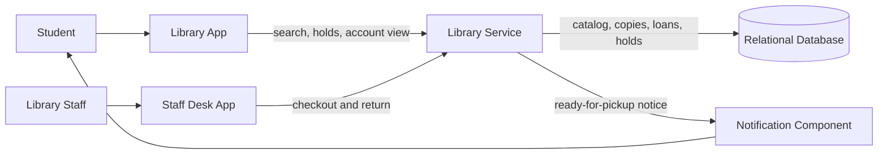
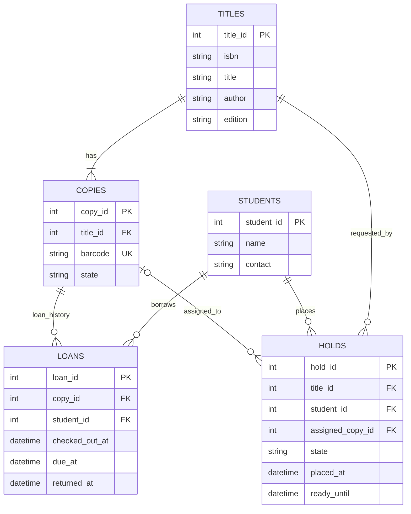

# Reference Solution — Library Book Loans & Holds

## 1. Clarify

Clarify the loan period, renewal policy, whether holds are per title or edition, how long an assigned copy waits for pickup, whether students with overdue books may borrow, and what staff correction/audit rules are needed. The initial design assumes one library branch, hold requests for a title/edition, FIFO ordering, a configured pickup window, and no fines or inter-branch transfers.

The key distinction is between a catalog title and a physical copy. Invariants: one active loan per copy; one active hold per student/title; a copy is in at most one of available, on-loan, or reserved-for-pickup state; and a returned copy goes to the earliest eligible waiting hold before becoming generally available.

## 2. Interactions

Students use `GET /catalog?q=...`, `GET /titles/{id}/availability`, `POST /titles/{id}/holds`, and `DELETE /holds/{id}`. Staff use `POST /copies/{id}/loans` and `POST /loans/{id}/return`. The library service enforces student ownership and staff permissions.

On checkout, the service selects and locks one available copy for the requested title, creates an active loan and marks the copy on loan in one transaction. On return, it closes the active loan, checks the title's oldest waiting hold, and either assigns the copy to that hold with a pickup deadline or marks it available. Notification is requested after commit. An expired ready hold releases or reassigns its copy to the next waiting hold.

## 3. Data Model

- `titles(title_id PK, isbn, title, author, edition)` is catalog-level metadata; ISBN can be indexed but is not necessarily unique for every local catalog record.
- `copies(copy_id PK, title_id FK, barcode UNIQUE, state)` tracks each physical item with state `AVAILABLE`, `ON_LOAN`, `HELD`, or `LOST`.
- `students(student_id PK, name, contact)` identifies borrowers and hold requesters.
- `loans(loan_id PK, copy_id FK, student_id FK, checked_out_at, due_at, returned_at)` records loan history. At most one row per copy may have `returned_at IS NULL`.
- `holds(hold_id PK, title_id FK, student_id FK, state, placed_at, ready_until, assigned_copy_id FK nullable)` records queue position and assignment. States include `WAITING`, `READY`, `FULFILLED`, `CANCELLED`, and `EXPIRED`; `(placed_at, hold_id)` defines FIFO order.

Checkout/return/hold promotion must be transactional around the copy and queue state. Use a partial unique constraint for active loans and for active holds per student/title. A ready hold's assigned copy is unavailable to general checkout until pickup, cancellation, or expiry.

## 4. Architecture Diagram

The notification component informs students when their hold is ready; it does not decide queue order. The library service and transactionally updated database own circulation state.

## 5. Database ERD

`COPIES o|--o{ HOLDS` reflects that a hold may not yet have a copy, and a copy can appear in historical hold assignments over time. A uniqueness rule ensures no more than one current `READY` hold is assigned to a given copy.

## 6. Walkthrough

All copies of a title are on loan, so a student places a hold. The service checks for an existing active hold for that student/title and inserts a `WAITING` hold with a committed timestamp. A copy is returned later. In one transaction, the service closes the loan, locks the copy and the title's waiting queue, selects the oldest waiting hold, changes it to `READY`, assigns the copy, sets `ready_until`, and changes the copy to `HELD`. After commit, it requests a pickup notification.

If the student does not pick it up before `ready_until`, an expiry operation locks the ready hold and copy, marks the hold `EXPIRED`, and either assigns the copy to the next waiting hold or sets it to `AVAILABLE`. Repeating the expiry check does not release or promote the same copy twice because the state transition is conditional on the hold still being `READY` and expired.

## 7. Design Decisions

Titles and copies are separate because one bibliographic record may have many independently loanable objects. Loan history is append-oriented and the active loan is identified by a null return timestamp. Holds attach to a title rather than a particular copy while waiting; once ready, they reference the assigned copy.

A relational database supports foreign keys, uniqueness rules, and atomic copy/loan/hold changes. A small notification component keeps email delivery from blocking return processing. The first-in-first-out queue is a query ordered by committed placement time and stable hold ID, not a separate queue broker.

## 8. Failure Cases & Trade-offs

- **Concurrent checkout:** Lock or conditionally update one available copy and enforce one active loan per copy. A losing staff request receives a clear conflict.
- **Duplicate return:** A second return sees the loan already closed and must not enqueue/publish the copy again.
- **Return and hold cancellation race:** Serialize both against the title/copy state and re-evaluate the next eligible hold in the transaction.
- **Notification failure:** The copy remains reserved for the assigned student until expiry; notification retry should not alter queue priority or copy state.
- **Expiry worker delay:** A copy may remain held slightly past its deadline. The checkout path should also treat an expired ready hold as eligible for safe release so correctness does not rely solely on a perfectly timed background job.
- **Damaged or lost copy:** Staff must have an explicit state transition that removes the copy from availability and does not leave an active loan/hold assignment inconsistent.

## 9. Improvements

Add renewal and overdue policies only after the library defines them. Multiple branches would require branch-scoped copies and a deliberate rule for local versus cross-branch holds. If notifications must survive a process crash between commit and send, write an outbox event in the same transaction as promotion. A hold offer that requires student confirmation can be added by introducing a separate offer state and expiry rule.
