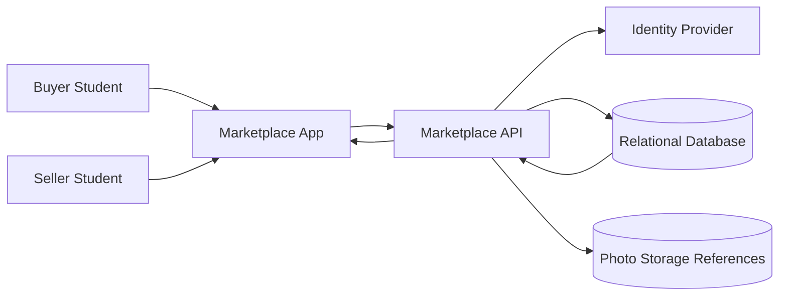
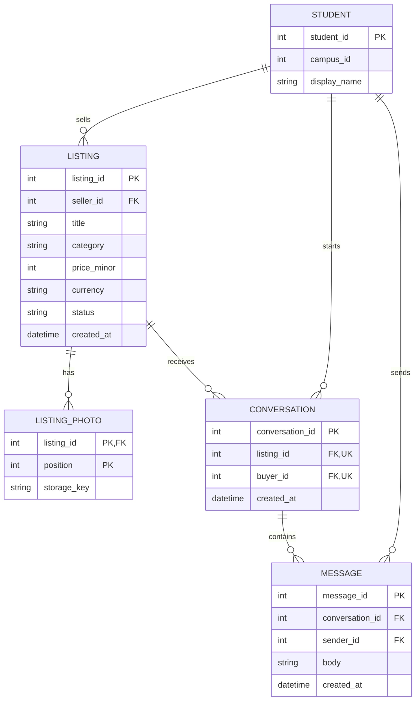

# Reference Solution — Student Marketplace

## 1. Clarify

The first release serves one campus, authenticated students, and one-item listings. It supports discovery and buyer-seller conversations; it does not reserve an item, take payment, or coordinate delivery. Treat a listing's lifecycle as `ACTIVE → SOLD` or `ACTIVE → REMOVED`. Both terminal states leave the record available for existing conversation history, but only active listings are discoverable and accept new conversations.

Assume photo references point to files already stored by a separate upload mechanism. Search is modest enough for database title/description matching. The key policy to confirm is whether a seller may reopen a sold listing; this design says no, and a new listing is created instead.

## 2. Interactions

Representative endpoints:

- `POST /listings` creates an active listing for the authenticated seller.
- `GET /listings?category=&q=&cursor=` returns active listings only.
- `PATCH /listings/{id}` and `POST /listings/{id}/sold` require seller ownership and an active listing.
- `POST /listings/{id}/conversations` creates or returns the buyer's conversation for that listing.
- `GET /conversations/{id}/messages` and `POST /conversations/{id}/messages` require the caller to be a participant.

Creating a conversation should check the listing is active in the same transaction that creates the conversation. A uniqueness rule on `(listing_id, buyer_id)` makes retries return the same conversation. Message access is checked against conversation participants, not merely the listing's visibility.

## 3. Data Model

- `Student(student_id PK, display_name, campus_id)` represents the authenticated account. `campus_id` is useful even in a one-campus launch because it makes the boundary explicit.
- `Listing(listing_id PK, seller_id FK, title, description, category, condition, price_minor, currency, status, created_at, updated_at, sold_at)` is owned by one seller. Store money as integer minor units plus currency, not binary floating point. `status` is constrained to the supported values.
- `ListingPhoto(listing_id FK, position, storage_key)` stores references, with `(listing_id, position)` as its key. The marketplace does not store image bytes in the relational row.
- `Conversation(conversation_id PK, listing_id FK, buyer_id FK, created_at)` is tied to one listing. Unique `(listing_id, buyer_id)` prevents duplicate conversation threads for a buyer/listing pair. The seller is derived from the listing, avoiding a second seller value that could disagree.
- `Message(message_id PK, conversation_id FK, sender_id FK, body, created_at)` belongs to a conversation. Application validation requires the sender to be either that listing's seller or the conversation's buyer.

Important invariants: only the seller may change listing state; only participants can read or write messages; sold and removed listings are excluded from search; a conversation's listing and buyer do not change after creation.

## 4. Architecture Diagram

The photo storage reference represents keys/metadata; uploading image bytes is outside this exercise. Both buyer and seller use the same application and API, with authorization based on the authenticated student.

## 5. Database ERD

The seller is the `STUDENT` referenced by `LISTING.seller_id`; the buyer is referenced by `CONVERSATION.buyer_id`. This avoids a duplicated seller foreign key on each conversation.

## 6. Walkthrough

Student A submits a listing. The API obtains A's identity from the authenticated session, validates required fields and price, then inserts an `ACTIVE` listing with `seller_id = A`. A cannot supply a different seller ID in the request. Student B searches; the query filters to `status = ACTIVE` and may filter category and text, then returns a stable page ordered by `(created_at, listing_id)`. B starts a conversation. The service checks that B is not the seller and that the listing remains active, then inserts or returns the unique `(listing_id, buyer_id)` conversation. When B sends a message, the service verifies B is a participant before storing it.

## 7. Design Decisions

One relational database keeps ownership, status, and conversation relationships easy to inspect and constrain. Listing state is a small explicit enum rather than inferred from nullable timestamps. Conversation is associated with a listing and buyer; deriving the seller from the listing prevents participant drift if data is repaired. Search starts with ordinary indexes and database text matching. A separate search engine is justified only by measured relevance or scale needs.

## 8. Failure Cases & Trade-offs

- A seller marks a listing sold while a buyer starts a conversation. Both paths should re-check and change/read listing state transactionally; if sale commits first, creation is rejected. A conversation committed first remains valid history.
- Two retries create the same conversation. The unique constraint is authoritative; the API reads and returns the existing thread after a conflict.
- A buyer guesses another conversation ID. Every message read/write query must join or check membership; opaque IDs alone are not authorization.
- A seller edits a listing while search is paginated. Stable ordering prevents arbitrary page movement, though edits to searchable fields can still change later result membership.
- Retaining conversations after removal protects history but requires an explicit retention/privacy policy.

## 9. Improvements

If search quality becomes a demonstrated problem, add a search index updated from listing changes and keep the relational database authoritative for status and ownership checks. If multiple campuses are introduced, include campus authorization in listing queries and consider a campus-scoped unique/search index. Reporting and moderation can be added with a `ListingReport` record and a reviewed status transition, without changing the basic seller ownership model.
