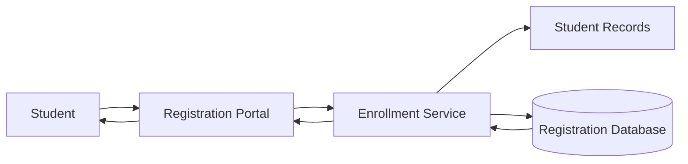
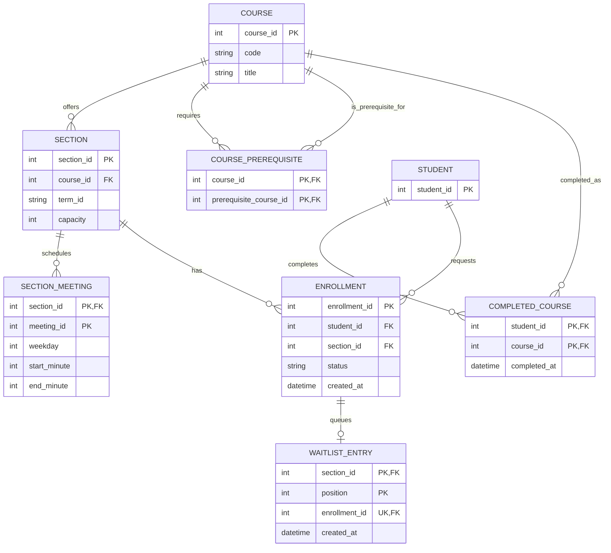

# Reference Solution — Course Enrollment & Waitlist

## 1. Clarify

Assume one academic term, authoritative student identity and completed-course history, and synchronous enrollment requests. A student is enrolled immediately when eligible capacity exists. A waitlisted student has no seat until promoted. Sections have a fixed capacity and one or more meeting intervals. A prerequisite is satisfied by a completed course in the authoritative record. For the first version, schedule conflicts are strict interval overlaps on the same term; institutional exceptions and course equivalencies are excluded.

The relational database is the source of truth. Correctness at the last seat and at waitlist promotion matters more than throughput. Confirm the registration deadline and whether waitlist promotion is immediate; the supplied prompt chooses immediate promotion.

## 2. Interactions

- `GET /sections?term=&course=` lists section details and current availability.
- `POST /sections/{id}/enroll` checks prerequisites, conflicts, and capacity, then enrolls or appends an eligible student to the waitlist.
- `DELETE /sections/{id}/enrollment` drops an enrollment or removes the caller's waitlist entry.
- `GET /students/{id}/enrollments` returns the student's active enrollments and waitlists.

For enrollment, the service reads the student's completed courses and active schedule, then starts a transaction, locks the section row, and checks active enrollment count. If there is a seat, it inserts an enrollment; otherwise, it inserts the next waitlist position. Validation and insertion need a consistent view of the student's active records. If a student enrolls concurrently in two sections, use a per-student transaction lock/serialization strategy or a retryable serializable transaction so both requests cannot pass conflicting schedule checks independently.

## 3. Data Model

- `Student(student_id PK)` identifies a student.
- `Course(course_id PK, code, title)` is catalog metadata.
- `Section(section_id PK, course_id FK, term_id, capacity)` is a scheduled offering. Capacity is positive and stable while enrollment is open.
- `SectionMeeting(section_id FK, meeting_id, weekday, start_minute, end_minute)` records weekly meeting intervals; `(section_id, meeting_id)` is the key.
- `CoursePrerequisite(course_id FK, prerequisite_course_id FK)` links a course to required completed courses. A self-reference and duplicate edge are rejected.
- `CompletedCourse(student_id FK, course_id FK, completed_at)` records authoritative completions, with `(student_id, course_id)` unique for the simple pass/fail prerequisite rule.
- `Enrollment(enrollment_id PK, student_id FK, section_id FK, status, created_at)` uses `ENROLLED`, `DROPPED`, or `WAITLISTED`. A partial unique constraint (or equivalent transaction check) allows at most one active row per student and section. A section's active `ENROLLED` count must not exceed capacity.
- `WaitlistEntry(section_id FK, position, enrollment_id FK UNIQUE, created_at)` provides FIFO order. `(section_id, position)` is unique; positions are allocated while holding the section lock. A dropped waitlist entry remains auditable or is marked inactive.

## 4. Architecture Diagram

The student records component supplies trusted completed-course data. The enrollment service coordinates checks and writes; the database transaction enforces seat allocation and waitlist ordering.

## 5. Database ERD

`WAITLIST_ENTRY` is optional for an enrollment: only rows in `WAITLISTED` status have one. Its unique enrollment foreign key prevents one enrollment from holding multiple queue positions.

## 6. Walkthrough

Student S requests section C. The service verifies required courses against `CompletedCourse` and compares the candidate section's meeting intervals to S's enrolled sections. It then serializes the capacity decision by locking C's `SECTION` row. If active enrollment count is below `capacity`, it creates an `ENROLLED` record; otherwise it appends a `WAITLISTED` enrollment with the next section-local position. The lock makes simultaneous last-seat requests observe the updated count in sequence.

When an enrolled student drops, the transaction marks that enrollment dropped and scans waitlist entries in position order. For each candidate it rechecks prerequisites and conflicts against current active enrollments. Ineligible candidates are removed/marked skipped; the first eligible candidate is changed to enrolled and its queue entry is closed. The transaction commits the drop and promotion together so the seat is never represented as both vacant and allocated across committed state.

## 7. Design Decisions

Separating `Course` from `Section` models course catalog facts independently from term-specific capacity and meeting time. Prerequisite edges are explicit and allow several requirements. Capacity is derived from active enrollment rows rather than a separately decremented counter, avoiding drift; if a cached count is added later, it must be updated transactionally. Waitlist positions are section-local and allocated under the same lock used for capacity. Schedule conflict checking is a business rule rather than a database exclusion constraint because it spans a student's multiple section rows.

## 8. Failure Cases & Trade-offs

- Concurrent final-seat requests serialize on the section row; a unique active-enrollment rule also protects repeated requests by the same student.
- Concurrent enrollments in different sections can each pass schedule checks unless student-level conflicts are serialized. A serializable transaction with retry, or locking a stable student row before validation, closes this race.
- A waitlisted student may become ineligible after joining. Promotion revalidates rather than assuming eligibility remains true.
- A failure during promotion must roll back both the drop and the candidate transition. If notifications are added, record an outbox event in the same transaction and send after commit.
- Row locking limits throughput for a very popular section, but is a reasonable trade-off for modest registration workloads and a strict seat invariant.

## 9. Improvements

An expiring acceptance offer would add `OFFERED` status, `expires_at`, and a scheduled expiration/promotion path. A registrar feed could update completed-course data asynchronously, with a visible refresh timestamp and a safe retry for rejected enrollments. If enrollment volume requires it, section capacity counts can be maintained transactionally, but the invariant should remain checked against authoritative enrollment state during reconciliation.
