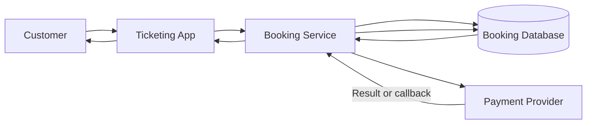
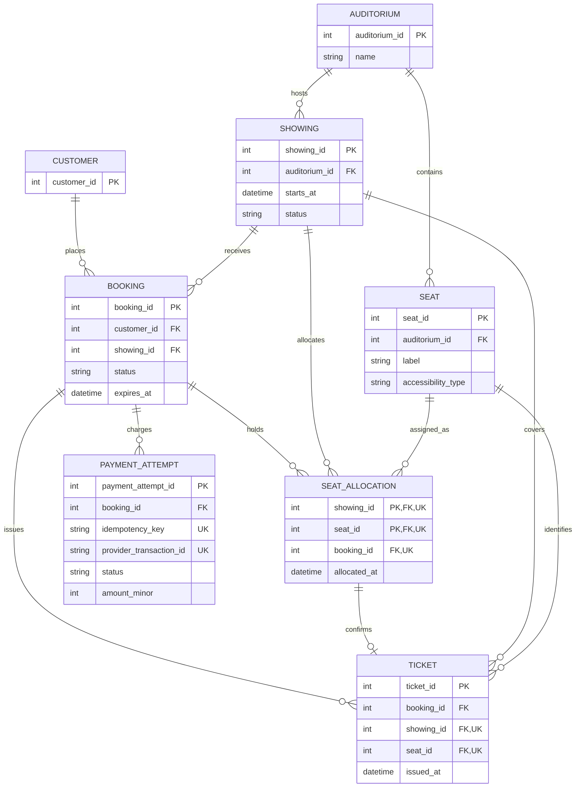

# Reference Solution — Movie Theater Seat Booking

## 1. Clarify

Assume one theater, fixed auditorium seating, showings with a known start time, and a five-minute hold. A hold is all-or-nothing for the requested seats. A payment is considered confirmed only when the provider reports success and the system can still atomically confirm the active hold. If the hold expires first, release it and reconcile a later provider success according to a refund/void policy; never silently issue a ticket for a seat now held by someone else.

The payment provider accepts an idempotency key and returns a stable transaction ID. Card details remain with the provider. A relational database is sufficient for the initial load; correctness is the primary goal.

## 2. Interactions

- `GET /showings/{id}/seats` returns a snapshot of seat state.
- `POST /showings/{id}/holds` requests a set of seat IDs and returns hold ID plus expiry if all seats are available.
- `POST /holds/{id}/payment` starts or resumes a payment using a stable idempotency key.
- `POST /payment-callbacks` records provider outcome idempotently.
- `GET /bookings/{id}/tickets` verifies ownership and returns issued tickets.

The hold operation transaction locks or conditionally inserts allocations for every requested `(showing_id, seat_id)`, in sorted seat order to reduce deadlocks. It commits only if all seats can be claimed. Payment is an external call and must not be made while holding a database lock. The service records a payment attempt, calls the provider, and finalizes after a response/callback in a short transaction.

## 3. Data Model

- `Customer(customer_id PK)` is the authenticated account.
- `Auditorium(auditorium_id PK, name)` contains physical seats.
- `Seat(seat_id PK, auditorium_id FK, label, accessibility_type)` has a globally unique seat ID and unique `(auditorium_id, label)`.
- `Showing(showing_id PK, auditorium_id FK, starts_at, status)` identifies a movie event. A showing uses seats from its auditorium.
- `Booking(booking_id PK, customer_id FK, showing_id FK, status, expires_at, created_at)` has `HELD`, `CONFIRMED`, `EXPIRED`, or `CANCELLED` state. Only a held booking has a future expiry.
- `SeatAllocation(showing_id FK, seat_id FK, booking_id FK, allocated_at)` has primary key `(showing_id, seat_id)` and a unique key `(showing_id, seat_id, booking_id)` for ticket references. It represents the current hold or sold allocation. The primary key is the central no-double-booking invariant. On expiry/failure, allocation rows are removed transactionally; on success, they remain attached to the confirmed booking.
- `PaymentAttempt(payment_attempt_id PK, booking_id FK, idempotency_key UNIQUE, provider_transaction_id UNIQUE nullable, status, amount_minor, created_at)` stores provider interaction without card data. The provider transaction ID makes repeated callbacks idempotent.
- `Ticket(ticket_id PK, booking_id FK, showing_id FK, seat_id FK, issued_at)` has unique `(showing_id, seat_id)` and is created only on confirmation. A composite foreign key `(showing_id, seat_id, booking_id)` references the matching seat allocation so a ticket cannot name another booking's seat or a seat from a different showing.

The service validates that each requested seat belongs to the showing's auditorium before allocation. The seat ID is globally unique, so each allocation has a valid foreign key to one physical seat; the cross-check against the showing's auditorium is a business constraint.

## 4. Architecture Diagram

Seat holds and ticket state live in the database. The provider is external; its outcome is reconciled with the booking rather than treated as a synchronous extension of a database transaction.

## 5. Database ERD

Enforce the showing-to-seat auditorium match in the hold transaction so a showing cannot allocate a seat from another auditorium. `SEAT_ALLOCATION` also has the additional unique key `(showing_id, seat_id, booking_id)` targeted by the ticket composite foreign key; it guarantees all three references name the same allocation.

## 6. Walkthrough

Customer C requests seats A4 and A5. The service validates that both belong to the showing's auditorium, creates a `HELD` booking with expiry, and attempts to insert both `SeatAllocation` rows in one transaction. The `(showing_id, seat_id)` primary key prevents another transaction from claiming either seat. If either insert conflicts, the transaction rolls back all requested allocations and no partial hold is returned.

C requests payment. The service records a payment attempt with an idempotency key, then calls the provider outside the transaction. On success, a short transaction locks the booking, checks `status = HELD` and `expires_at > current_time`, records the provider transaction, changes the booking to `CONFIRMED`, and inserts one ticket per allocation. A unique provider transaction and unique showing-seat ticket make repeated callbacks safe. Expiration and payment finalization use the same booking lock: whichever valid transition commits first determines the result. A late success after expiration enters reconciliation/refund handling and does not reclaim seats automatically.

## 7. Design Decisions

The allocation table makes the uniqueness invariant directly enforceable by the database; an availability screen is only a snapshot, never a guarantee. All requested seats are held in one transaction. Payment is not performed while holding locks because provider latency could block booking traffic. Tickets are separate durable records issued only after confirmation. Store amounts in minor units and do not store sensitive card data.

## 8. Failure Cases & Trade-offs

- Two customers request the same final seat. The unique allocation key chooses one winner; the other transaction rolls back as a conflict.
- A hold expires while payment is pending. The expiry worker conditionally transitions only still-held expired bookings and releases allocations. A concurrent finalizer checks the same expiry and lock.
- Provider success is received twice. Unique transaction ID and booking state make the second callback a no-op.
- Provider accepted payment but the caller timed out. Retry with the same idempotency key; reconcile by provider transaction/callback before issuing tickets.
- Provider reports success after seat release. Do not silently confirm. Mark payment for compensation and refund/void it; manual review is appropriate if the provider cannot guarantee reversal.
- Expiration workers may run late. When a new hold finds an allocation whose booking has expired, the transaction locks that booking, changes it to `EXPIRED`, removes all of its allocations, then retries the requested-seat inserts before committing. This preserves all-or-nothing holds without relying only on a timely background job.

## 9. Improvements

If callbacks need durable asynchronous handling, record callback events in an inbox table and process them idempotently. Add an outbox for ticket email after confirmation. A cache may improve seat-map reads, but it must never authorize a hold. Multiple theaters would require tenant-scoped administration and seat-map versioning; neither is needed for the first release.
