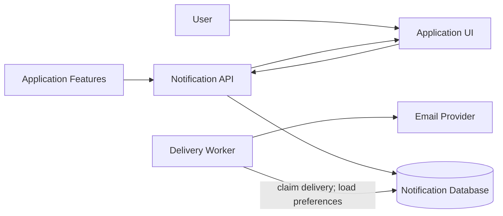
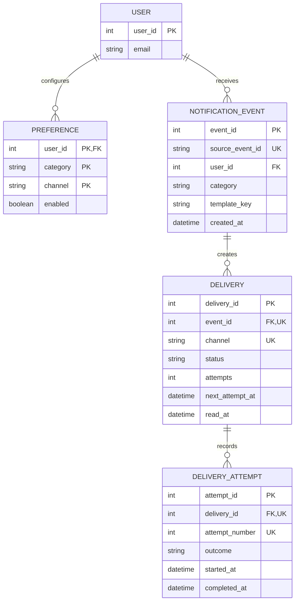

# Reference Solution — Notification Delivery System

## 1. Clarify

An internal feature submits a stable event ID, one recipient, a notification category, and rendering data. The service produces an in-app record for supported events and email according to preferences. Security-required email ignores an opt-out; optional categories respect the current preference at dispatch time. “Delivered” means accepted by the email provider, not confirmed in the recipient's inbox.

Use a relational database and a worker that claims pending delivery rows. A broker is unnecessary for the initial system. Retry transient failures three times with increasing delays; mark permanent errors failed. Clarify how preference changes affect work already queued; this design evaluates preference when the worker is ready to send and suppresses optional work if the current preference is off.

## 2. Interactions

- `POST /internal/notification-events` accepts an authenticated service event with stable `source_event_id`.
- `GET /notifications` lists the caller's in-app messages; `PATCH /notifications/{id}/read` marks one read.
- `GET/PUT /notification-preferences` reads or changes category/channel choices.
- A worker claims due `PENDING`/retryable `FAILED` delivery rows, evaluates preferences, invokes email provider, then records outcome.

Intake inserts one `NotificationEvent` idempotently, then creates channel delivery rows under a unique `(event_id, channel)` constraint. The event and rows are committed together. The worker marks a delivery `SENDING` and records an attempt before making the external call. Because a timeout can occur after provider acceptance, use a stable provider idempotency key where supported; otherwise explain at-least-once delivery and possible duplicate email.

## 3. Data Model

- `User(user_id PK, email)` is the recipient.
- `Preference(user_id FK, category, channel, enabled)` has key `(user_id, category, channel)`. Required policy for security email is enforced by the service and cannot be disabled by user preference.
- `NotificationEvent(event_id PK, source_event_id UNIQUE, user_id FK, category, template_key, payload, created_at)` stores one logical source event. Keep payload minimized and avoid secrets.
- `Delivery(delivery_id PK, event_id FK, channel, status, attempts, next_attempt_at, read_at, provider_message_id, last_error_code)` has unique `(event_id, channel)`. `read_at` is used only for in-app channel rows. Status includes pending, sending, sent, suppressed, and failed.
- `DeliveryAttempt(attempt_id PK, delivery_id FK, attempt_number, started_at, completed_at, outcome, provider_message_id)` records bounded retry history; unique `(delivery_id, attempt_number)`.

One event belongs to one recipient, so user identity is not repeated in each delivery. Delivery state is per channel because email can fail while in-app persistence succeeds.

## 4. Architecture Diagram

The database stores event and delivery state and also acts as the initial work queue. The email provider is external. In-app notifications are returned by the API from persisted delivery records.

## 5. Database ERD

`DELIVERY` has a composite unique key `(event_id, channel)` and `DELIVERY_ATTEMPT` has `(delivery_id, attempt_number)` even though each also has a surrogate primary key. Preference rows may be absent; use category defaults, with required security policy taking precedence.

## 6. Walkthrough

The password-reset feature submits event `reset-abc` for user U. The API inserts the event using `source_event_id`; on duplicate submission it returns the existing result. In the same transaction it creates the required email delivery and, if the event type supports it, an in-app delivery. A worker claims the email row and reads the current security policy and user preference. Security email is sent regardless of an opt-out. It records attempt 1 and calls the provider with a stable delivery key. If the provider returns a transient error, the worker stores the outcome and next retry time. A later worker attempt reuses the same logical delivery. When accepted, state becomes `SENT`; duplicate event intake or worker replay does not create a second delivery row. The user sees in-app notifications through a query scoped to their authenticated user and can mark the row read.

## 7. Design Decisions

Separate event identity from per-channel delivery so one channel can succeed while another fails. A database-backed queue is enough for a small service and keeps state inspectable. Claiming work should use a short lease or row lock, with lease expiry allowing recovery if a worker crashes in `SENDING`. Stable event and provider keys provide practical idempotency. Preferences are evaluated at dispatch time to avoid sending optional content after an opt-out; if product policy instead promises the preference snapshot at event creation, store that snapshot explicitly.

## 8. Failure Cases & Trade-offs

- Provider accepts an email but the worker times out before recording success. A provider idempotency key prevents a duplicate where supported; otherwise a retry may send twice. Exactly-once external delivery cannot be guaranteed by the local database alone.
- Worker crashes after marking `SENDING`. A lease expiry returns the row to retryable state; attempt history makes the ambiguity observable.
- Duplicate event arrives with same source ID but different payload. Reject it as an idempotency conflict rather than silently changing an already-created notification.
- Preference changes while queued. The worker's dispatch-time check suppresses optional delivery; security-required email remains required.
- Sensitive content can leak through payloads, logs, or provider error text. Minimize payload, redact logs, and retain only necessary delivery metadata.
- In-app and email outcomes are independent; do not roll back a persisted in-app message because email failed.

## 9. Improvements

If due-row polling becomes a bottleneck, publish delivery IDs to a broker using a transactional outbox while preserving the database row as source of truth. Add provider webhooks for bounce state if the product needs it. Add per-user rate limits and quiet hours only when policy requires them. A dead-letter review interface can be introduced for persistent failures without changing event idempotency.
