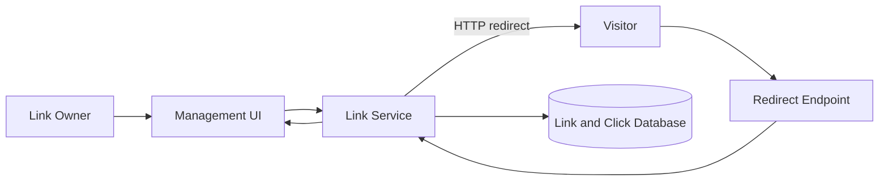
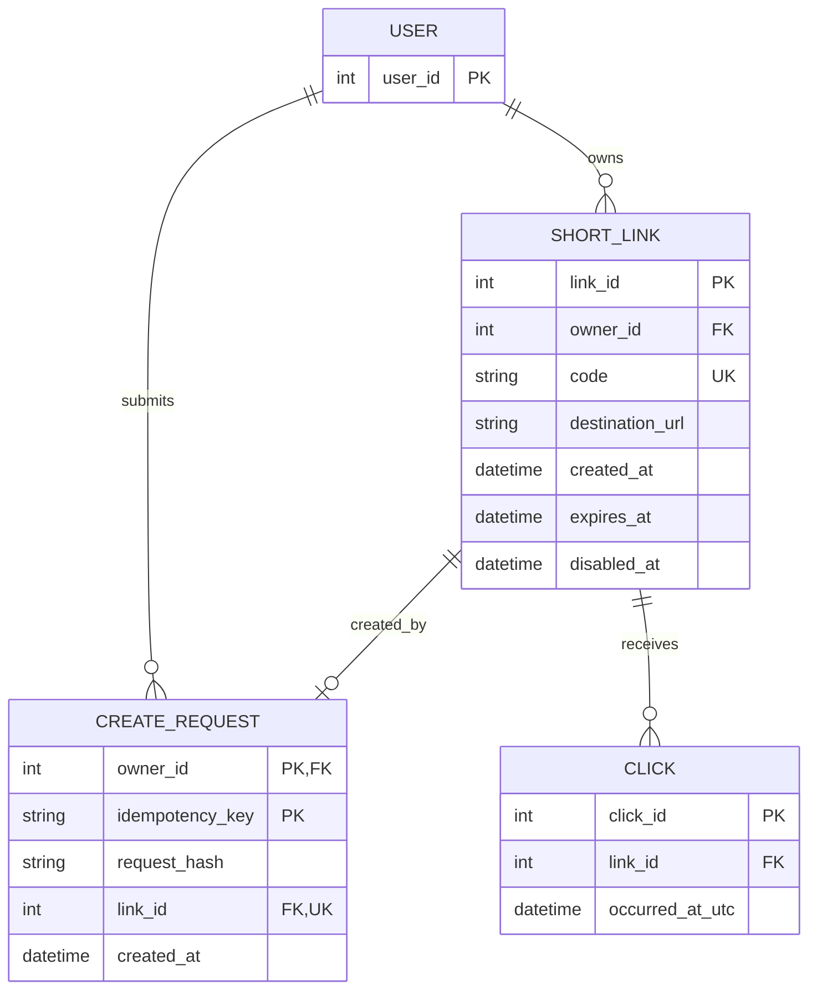

# Reference Solution — URL Shortener & Click Analytics

## 1. Clarify

Users create HTTP/HTTPS short links, optionally with an alias, and redirect visitors. Owners can set expiration, disable a link, and query UTC daily click counts. Assume authenticated owners; visitors can resolve active codes without logging in. No per-person analytics are needed. The database is authoritative, and there is no assumed request volume that justifies a cache or distributed counter.

Generated codes use a URL-safe random alphabet with enough entropy for the expected small deployment. Storage uniqueness is authoritative: on a collision, generate another code and retry. For a requested alias conflict, return a conflict. A client idempotency key is scoped to the owner and creation operation.

## 2. Interactions

- `POST /links` creates a link with destination, optional alias, and optional expiry.
- `GET /{code}` resolves the code and redirects only if active and unexpired.
- `POST /links/{id}/disable` is owner-only and idempotently disables the link.
- `GET /links/{id}/analytics?from=&to=` verifies owner access and returns per-UTC-day counts.

Creation validates scheme/host and persists the owner-scoped idempotency key and link in one transaction. Redirect reads by unique code, checks disabled/expiry state using UTC server time, then records a click and returns a redirect. A simple version writes a click row synchronously; this gives durable accounting but couples redirect availability to the database. A later version could use an outbox or buffered events if measurements show write latency is unacceptable.

## 3. Data Model

- `User(user_id PK)` owns links.
- `ShortLink(link_id PK, owner_id FK, code UNIQUE, destination_url, created_at, expires_at nullable, disabled_at nullable)` stores a URL-safe code. The destination can be changed only under an explicit audited policy; this initial design treats it as immutable.
- `CreateRequest(owner_id FK, idempotency_key, request_hash, link_id FK, created_at)` has key `(owner_id, idempotency_key)`. Reusing the key with the same request returns the original link; a different request hash is a conflict.
- `Click(click_id PK, link_id FK, occurred_at_utc)` records one accepted redirect event. Index `(link_id, occurred_at_utc)` supports date-grouped counts. Do not store visitor identity or IP in this scope.

The code unique constraint prevents collision from overwriting. A link resolves only when `disabled_at IS NULL` and `expires_at IS NULL OR expires_at > now_utc`. Analytics count click rows in half-open UTC intervals `[start, end)` to avoid double-counting midnight boundaries.

## 4. Architecture Diagram

The same service handles management and redirect requests, but authorization differs: management operations require owner identity while code resolution is public. Click persistence is shown in the database because the initial design records clicks synchronously.

## 5. Database ERD

`CREATE_REQUEST.link_id` points to the one link created for that idempotency key. It is unique if each link is created by exactly one request record; the link may have no request record for administrative creation.

## 6. Walkthrough

Owner O submits a destination and idempotency key `create-42`. The service validates HTTP/HTTPS, computes a request hash, and checks the owner-scoped key. It generates a candidate code and inserts the `ShortLink` and `CreateRequest` in one transaction. If the unique code constraint collides, it retries with a new candidate; if the idempotency key already exists, it returns the prior link if the request hash matches.

A visitor requests the code. The service looks up the unique code and checks status and expiry using UTC. It inserts a click with the current UTC timestamp and returns a redirect to the stored destination. For analytics, the service verifies O owns the link, then counts clicks whose timestamp falls in each requested UTC day. It uses a half-open interval so a click exactly at midnight belongs to one day only.

## 7. Design Decisions

Random codes avoid exposing sequential link counts and are simple to generate at this scale; the database unique constraint resolves the rare collision safely. A user-selected alias uses the same uniqueness rule. Click rows preserve an auditable event and allow new aggregates later, at the cost of a write on every redirect. A daily aggregate table can improve reporting, but should be derived idempotently from click events. Link state remains in the primary database so expiration and disablement checks are authoritative.

## 8. Failure Cases & Trade-offs

- Generated code collision: retry on unique violation, never overwrite another destination.
- Alias already taken: return conflict and leave existing link unchanged.
- Retry after client timeout: owner-scoped idempotency key returns the original link; mismatched payload is rejected.
- Expiration boundary: use a single UTC clock convention and strict `expires_at > now`; exactly-at-expiry is expired.
- Analytics insert fails while lookup succeeds. Synchronous durability means the redirect may fail or be delayed; a product can choose best-effort redirect with asynchronous click recording, but must accept possible lost analytics and provide durable buffering if loss matters.
- Repeated HTTP requests from one visitor count as repeated clicks by definition. Deduplicating people would require identity/cookie rules and privacy decisions not in the initial scope.
- Malicious destinations: validate schemes and consider abuse review; URL validation alone does not establish destination safety.

## 9. Improvements

If redirect latency or database write pressure is measured to be high, separate click ingestion into a durable queue/outbox and aggregate daily counts asynchronously, accepting a stated freshness delay. Add a cache only for link lookup after defining invalidation behavior for disablement and destination changes. If destination edits are allowed, add change history and an optimistic version check. Per-link abuse controls or a review workflow can be added when a real policy requires them.
