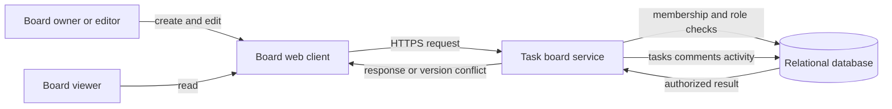
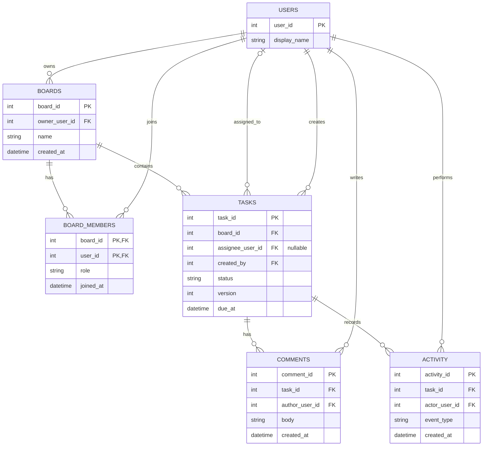

# Reference Solution — Collaborative Task Board

## 1. Clarify

Assume identity is supplied by the campus platform and each request includes a trusted user ID. A board has exactly one owner, plus editors and viewers. The owner is always allowed to administer membership; removing an editor or viewer revokes access immediately for subsequent requests. An assignment must point to a current board member. A removed member's task is retained but unassigned.

Use a relational database as the source of truth. Each task stores its current state for efficient board reads. Activity entries are append-only and are written in the same transaction as the task change. Edits include the version the client last read; a stale version gets a conflict response and the client reloads before retrying. This favors preventing silent lost updates over last-write-wins.

## 2. Interactions

Representative endpoints:

- `POST /boards` creates a board for the current user.
- `GET /boards/{board_id}/tasks` lists tasks after verifying membership.
- `POST /boards/{board_id}/members` lets the owner add a user with editor/viewer role.
- `PATCH /tasks/{task_id}` changes editable fields with an expected version.
- `POST /tasks/{task_id}/comments` adds a comment.
- `GET /tasks/{task_id}/activity` returns chronological activity.

The service derives the actor from authentication, checks board membership and role, validates the requested transition/assignee, updates the task, increments its version, and appends an activity row in one database transaction. The response returns the new task version and activity ID.

## 3. Data Model

- `users(user_id PK, display_name)` is the existing campus identity reference.
- `boards(board_id PK, name, owner_user_id FK -> users, created_at)` identifies a board and its owner.
- `board_members(board_id FK -> boards, user_id FK -> users, role, joined_at, PK(board_id, user_id))` stores editor/viewer membership. A constraint excludes owner from duplicate non-owner membership, or the owner is represented only by `owner_user_id` and checked separately.
- `tasks(task_id PK, board_id FK -> boards, title, description, status, due_at, assignee_user_id FK -> users nullable, version, created_by FK -> users, updated_at)` stores the current task snapshot. The service verifies an assignee is a member of the same board; a composite membership FK can enforce this when nullable-assignee semantics are handled.
- `comments(comment_id PK, task_id FK -> tasks, author_user_id FK -> users, body, created_at)` stores discussion.
- `activity(activity_id PK, task_id FK -> tasks, actor_user_id FK -> users, event_type, details, created_at)` records task creation, assignment/status changes, and comments. `details` stores the relevant before/after values.

Invariants: only authorized board members read; only owner/editor writes; there is one membership row per user/board; assigned users belong to the board; task version increases once per accepted edit; every accepted task edit has its activity row committed atomically. Deleting membership sets affected assignments to null and records the assignment change, within a transaction.

## 4. Architecture Diagram

## 5. Database ERD

`TASKS.assignee_user_id` is optional; every non-null assignment is validated against `BOARD_MEMBERS` for that task's board. Activity is per task, so this initial design does not claim to be a complete board-wide audit log.

## 6. Walkthrough

An editor reads task version 7 and submits a status change with `expected_version=7`. The API authenticates the editor, loads the task and board, and verifies the editor's current membership. In a transaction it performs a conditional update where `version=7`, setting the new status and version 8. If no row is updated, another editor won the race and the request returns a conflict without writing activity. If the update succeeds, the service inserts the `status_changed` activity row and commits both writes. It then returns version 8; clients that reload see the same current state and history.

## 7. Design Decisions

A relational database fits the relationships and transactional requirement between task state and history. Keeping a current snapshot avoids rebuilding a board from every historical event. The activity table is useful for user-facing history, but it is not used as an event-sourcing system: the task row remains authoritative.

Role checks are performed server-side on every request. Hiding edit controls in the client is only a usability choice. A simple version column and conditional update prevent accidental lost edits without requiring a collaboration framework. Ordinary refresh is enough for the initial scope; it avoids adding a push subsystem before users require live updates.

## 8. Failure Cases & Trade-offs

- If the task update succeeds but activity insertion fails, the transaction rolls back both, preserving the invariant.
- If membership is removed concurrently with an edit, both operations must serialize through a transaction/locking strategy or use a single authorization-and-write transaction; requests authorized before removal may complete first, while requests after the committed removal fail.
- A stale edit returns conflict. The user must reload or merge changes; this is safer than silently overwriting another editor.
- Comments and activity can grow. Paginate them by `(created_at, id)` and retain task activity according to an explicit policy if storage becomes material.
- If a removed user authored a comment or activity, retain the row for history; do not cascade-delete it with membership.

## 9. Improvements

If users need live updates, add a push channel that publishes committed task/activity IDs. Clients still fetch a snapshot and use a cursor after reconnecting; push messages are hints, not the durable source of truth. If boards become large, add indexed filtering and pagination before considering a search service. Multi-assignee tasks would need a task-assignee join table and explicit rules for removing a member who is assigned to work.
