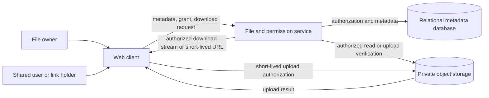
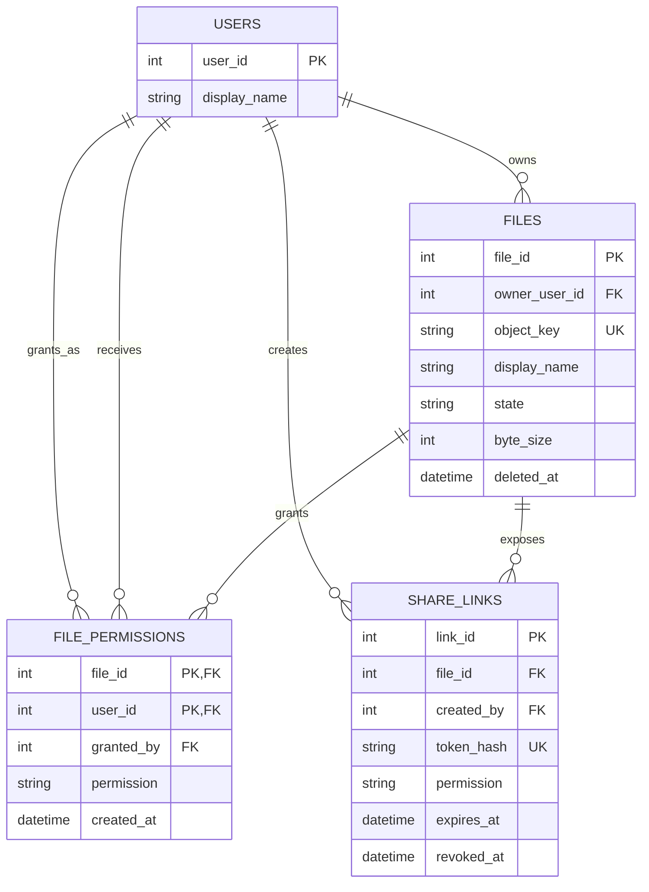

# Reference Solution — File Sharing & Permissions

## 1. Clarify

Authentication is provided by the campus identity system. File bytes live in a private object store; the relational database contains metadata and the opaque object key. Each file has one owner, direct user grants, and optional bearer links. A direct grant gives `viewer` or `editor`; the owner alone manages grants, links, and deletion. Editors may rename but cannot replace bytes in this version.

Uploads use a pending row followed by byte upload and finalization. Only `ready` files are visible/downloadable. Share tokens are high entropy, shown once, and stored as hashes. Expiration is checked by the service. A signed object-store URL, if used, is short-lived and can remain usable until expiry even after revocation; use a download proxy if immediate revocation is a hard requirement.

## 2. Interactions

Representative endpoints:

- `POST /files/uploads` creates pending metadata after checking size/type declarations.
- `POST /files/{id}/finalize` verifies the uploaded object's size and expected metadata, then marks the file ready.
- `GET /files/{id}` and `GET /files/{id}/download` authorize owner or direct grant.
- `POST /files/{id}/permissions` and `DELETE /files/{id}/permissions/{user_id}` manage direct grants.
- `POST /files/{id}/links` creates a permission-limited link; `DELETE /files/{id}/links/{link_id}` revokes it.
- `GET /shared/{token}` hashes the token, checks status/expiry/file state, and issues a download.

For upload, the application creates a random object key and pending record, then the client uploads to private storage using a narrow, short-lived upload authorization. Finalization verifies that the object exists and matches policy before exposing it.

## 3. Data Model

- `users(user_id PK, display_name)` references campus users.
- `files(file_id PK, owner_user_id FK -> users, object_key UNIQUE, display_name, declared_type, byte_size, state, created_at, deleted_at)` stores `pending`, `ready`, or `deleted` metadata.
- `file_permissions(file_id FK -> files, user_id FK -> users, permission, granted_by FK -> users, created_at, PK(file_id, user_id))` stores one current direct grant per recipient.
- `share_links(link_id PK, file_id FK -> files, token_hash UNIQUE, permission, expires_at, revoked_at, created_by FK -> users, created_at)` stores revocable capability records. `permission` is constrained to viewer/editor; owner privileges cannot be delegated.
- `upload_attempts` is optional if retries/audit are needed; the first version can keep a pending file row and store-provider multipart upload ID separately.

Invariants: object keys are unique and never accepted from an untrusted client as authorization; only ready files are accessible; every operation checks current file state and caller permissions; direct grants are unique per file/user; a link grants no more permission than its stored level and is rejected if expired/revoked/deleted. Deleted file metadata is retained for cleanup/audit while the object is removed asynchronously.

## 4. Architecture Diagram

## 5. Database ERD

The object store is not a relational entity: `FILES.object_key` points to an object, not to a database row. The ERD intentionally does not model a signed URL as persistent data.

## 6. Walkthrough

The owner starts an upload. The service validates declared size and type, generates an unguessable object key, inserts a `pending` file row, and returns a narrowly scoped upload authorization. After the client uploads, finalization asks the object store for the actual object metadata, checks configured limits, then conditionally changes `pending` to `ready`. A failed upload leaves no visible file; a cleanup job removes old pending rows and orphaned objects. A download request reloads the file and current grants before streaming bytes or issuing a short-lived signed URL.

## 7. Design Decisions

The database owns identity, ownership, permission, and lifecycle decisions; object storage owns large byte streams. This keeps metadata queries and access checks transactional without putting large files in relational rows. Direct grants are normalized into a join table, while links are separate because they have secrets, expiry, and revocation fields.

The service checks authorization before each download. A short-lived signed URL reduces application bandwidth but delays revocation until it expires. Proxying bytes gives tighter enforcement at a cost in bandwidth and application complexity. Either is defensible if the behavior is stated.

## 8. Failure Cases & Trade-offs

- Upload succeeds but finalize fails: keep the file hidden in `pending`, retry finalization idempotently, then clean up abandoned objects.
- Database says ready but the object is missing: return a controlled unavailable error, mark/alert on the inconsistency, and do not silently fabricate a file.
- Two finalize calls race: use a conditional state transition so only one changes pending to ready; duplicate finalization returns the already-ready result.
- Grant revocation races with URL issuance: serialize or recheck grant status at issuance. A previously issued signed URL may remain valid until expiration; choose a short TTL or a proxy when stricter revocation is required.
- A guessed or leaked bearer token can be used by anyone holding it. Store only the token hash, scope it to one file and permission, expire it, allow revocation, and rate-limit failed token lookups.

## 9. Improvements

If the application supports very large resumable uploads, persist multipart upload sessions and reconcile incomplete parts. Add malware scanning and mark files quarantined until scan completion only when policy requires it. Folders and inherited access require explicit precedence rules for direct grants, inherited grants, and revocation; they should not be introduced as a cosmetic schema extension.
