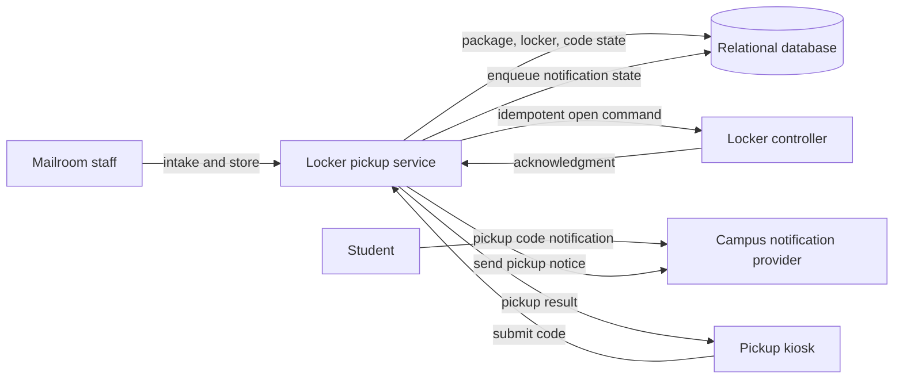
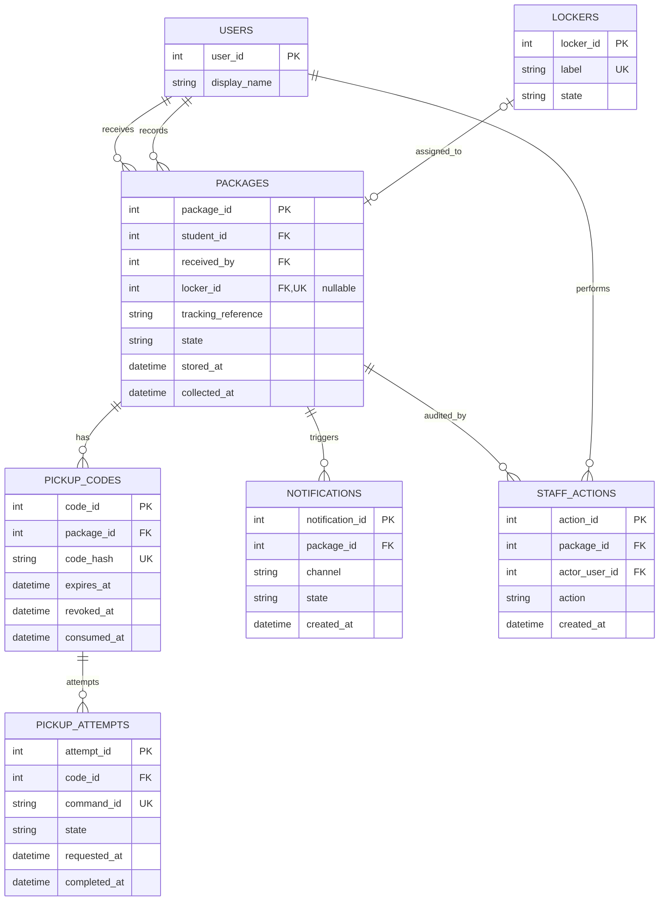

# Reference Solution — Campus Parcel Locker Pickup

## 1. Clarify

Assume staff and students authenticate through the campus directory. One mailroom manages a set of lockers. A locker becomes occupied when staff confirm that a package was placed inside and remains occupied until collection is confirmed or staff record removal. Code expiry or revocation does not free a physical locker.

The relational database is the system of record for packages, assignments, code state, and staff actions. The locker controller is an external device. Its open operation accepts an idempotent command ID and reports success/failure. If a real controller lacks idempotency, the service must reconcile ambiguous timeouts instead of issuing unbounded duplicate opens.

## 2. Interactions

Representative endpoints:

- `POST /staff/packages` records a received parcel for a student.
- `POST /staff/packages/{id}/store` assigns a selected/free locker and creates a pickup code.
- `POST /kiosk/pickups` submits a code and kiosk/locker context.
- `POST /staff/packages/{id}/return` records removal and frees a locker.
- `POST /staff/packages/{id}/codes` revokes an old code and issues a replacement.
- `GET /staff/packages/{id}` displays package and notification state to authorized staff.

On pickup, the service hashes and looks up the code, checks expiry, package state, and attempt limit, then conditionally claims the still-unclaimed code and creates a pending pickup attempt in one transaction. Only one concurrent request can claim it. It sends one open command to the associated locker. On controller success, one transaction consumes the code, marks the package collected, clears the package's locker assignment, and marks the locker free. A retry with the same command ID returns or reconciles the same attempt; a new command cannot reuse a claimed or consumed code. The kiosk receives a generic failure for invalid codes.

## 3. Data Model

- `users(user_id PK, display_name)` stores students and staff identity references; staff authorization comes from campus roles.
- `lockers(locker_id PK, label UNIQUE, state)` stores each physical compartment as available/occupied/maintenance.
- `packages(package_id PK, tracking_reference, student_id FK -> users, received_by FK -> users, state, locker_id FK -> lockers nullable UNIQUE, received_at, stored_at, collected_at)` stores package lifecycle. A unique nullable locker assignment prevents two stored packages sharing one locker.
- `pickup_codes(code_id PK, package_id FK -> packages, code_hash UNIQUE, expires_at, revoked_at, claimed_at, consumed_at, failed_attempts)` stores verifiers and lifecycle; enforce at most one usable code per package.
- `pickup_attempts(attempt_id PK, code_id FK -> pickup_codes, command_id UNIQUE, state, requested_at, completed_at, failure_reason)` records an unlock request for idempotent retry/reconciliation.
- `notifications(notification_id PK, package_id FK -> packages, channel, state, created_at, sent_at)` tracks notification delivery separately from package creation.
- `staff_actions(action_id PK, package_id FK -> packages, actor_user_id FK -> users, action, created_at)` is an audit trail.

Invariants: only a received package can be stored; only one stored package occupies a locker; a stored package references exactly one occupied locker; codes are single-use and time-limited; code expiration alone never frees a locker; package and locker transitions are committed together after controller success; retrying a command ID cannot open a different locker.

## 4. Architecture Diagram

## 5. Database ERD

The locker-to-package relationship is optional on the package side while a parcel is in the mailroom; a unique nullable `locker_id` allows at most one assigned package per locker. The service transaction also keeps `LOCKERS.state` and package state aligned.

## 6. Walkthrough

Staff records a package, then stores it. In a transaction, the service selects an available locker with a row lock (or performs a conditional update from available to occupied), inserts/updates the package assignment, creates a high-entropy code, and records the staff action. After commit, a notification worker sends the plaintext code to the student; the database retains only its hash.

At pickup, the kiosk submits the code. The service finds the verifier, checks expiry, unused state, and attempt policy, and records a claimed code plus unique command ID. The controller opens that locker and acknowledges the command. On success the service commits code consumption, package collection, locker release, and audit event together. If the response is ambiguous, the attempt stays pending for reconciliation; the code cannot initiate a second unrelated open.

## 7. Design Decisions

The physical locker cannot participate in a database transaction. The design therefore makes the boundary explicit: reserve/claim in the database, send a command with stable identity, then commit the final state after acknowledgement. Idempotent controller commands reduce duplicate opens. A pending attempt preserves enough evidence to reconcile a timeout.

The one-time code is a bearer secret, so store a hash, rate-limit guesses, and return uniform invalid responses. A notification is a separate side effect; tracking its state allows staff to retry delivery without creating another package. A simple relational model is appropriate for one mailroom and makes locker/package invariants inspectable.

## 8. Failure Cases & Trade-offs

- No locker is available: leave the package in received state and show staff that it remains in the mailroom.
- Notification fails: retry notification delivery using the same package/code record; do not create another package. If the plaintext code is not retained, issue a replacement instead of attempting to reconstruct it.
- Controller rejects an open command: mark the attempt failed, leave package/locker occupied, and allow a controlled retry after investigation.
- Controller opens but acknowledgment is lost: keep attempt pending and reconcile using command status or staff inspection. Do not free the locker solely because a timeout occurred.
- Two staff requests claim the last locker: a database lock/conditional state update permits only one assignment.
- Pickup code is guessed: cap attempts, rate-limit by kiosk/code source, and avoid revealing package ownership.

## 9. Improvements

For multiple mailrooms, add a location entity and scope locker uniqueness/permissions to it. Add a durable outbox for notifications and controller commands if the service needs crash-safe dispatch. If controller hardware cannot report command status, provide a staff reconciliation workflow that compares physical occupancy with recorded state. These operational controls address actual device uncertainty without introducing a general distributed event platform.
