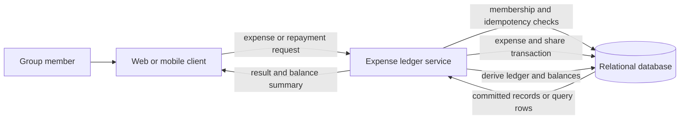
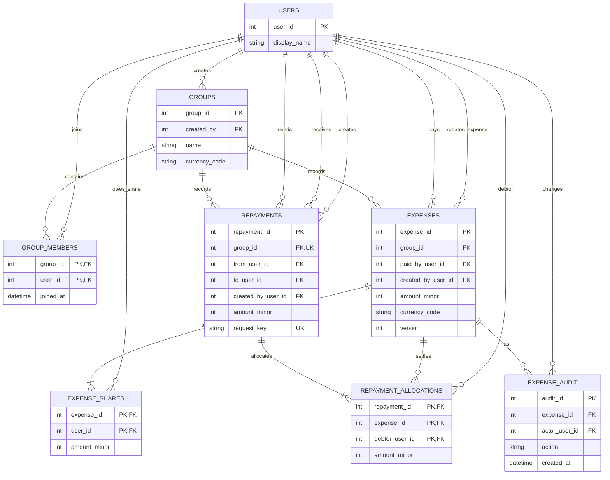

# Reference Solution — Shared Expense Splitter

## 1. Clarify

Assume users and authentication already exist. A group has one currency, and only members can see or modify its records. Expenses and repayments are accounting records, not payment instructions. Each repayment is allocated to one or more outstanding expense shares, so the system can determine exactly which obligations have been settled. Balances are derived from immutable or auditable source entries rather than being the only stored truth.

Persist money as integer minor units. For equal splits, sort participant IDs and allocate leftover minor units one at a time in that deterministic order. Explicit shares are supplied in minor units and must sum to the expense total. A repayment identifies outstanding shares it settles, and its allocations must sum to the repayment total without exceeding any share's unpaid amount. An expense can be edited/deleted only before any of its shares have allocations; afterward correct it with a compensating expense or repayment. Repayments and allocations are immutable and idempotent by client request key.

## 2. Interactions

Representative endpoints:

- `POST /groups` creates a group and its initial membership.
- `POST /groups/{id}/expenses` records a purchase and its participant shares.
- `GET /groups/{id}/balances` derives each member's net position.
- `GET /groups/{id}/ledger` returns expenses, shares, and repayments.
- `POST /groups/{id}/repayments` records an off-app transfer with an idempotency key.
- `PATCH /expenses/{id}` edits an unsettled expense with a version check.

An expense request is validated for group membership, currency, positive total, payer membership, and participant membership. The service calculates shares in minor units, verifies the share sum, then inserts the expense and all share rows in one transaction. On retry with the same idempotency key, it returns the original result rather than inserting a duplicate.

A repayment request names the outstanding shares it pays. In one transaction the service locks or conditionally updates those shares, verifies the expense and repayment belong to the same group and currency, verifies each debtor and expense payer match the sender and receiver, checks that no allocation exceeds its remaining amount, and inserts the repayment plus allocation rows. A unique `(group_id, request_key)` makes the whole operation idempotent. An expense edit uses the same transaction to verify its version and that no share has an allocation before replacing the shares and writing the audit snapshot.

## 3. Data Model

- `users(user_id PK, display_name)` stores identity references.
- `groups(group_id PK, name, currency_code, created_by FK -> users)` has exactly one currency.
- `group_members(group_id FK -> groups, user_id FK -> users, joined_at, PK(group_id,user_id))` defines access.
- `expenses(expense_id PK, group_id FK -> groups, paid_by_user_id FK -> users, created_by_user_id FK -> users, description, amount_minor, currency_code, version, deleted_at, created_at)` stores the payer's outlay. Its currency must match the group's currency.
- `expense_shares(expense_id FK -> expenses, user_id FK -> users, amount_minor, PK(expense_id,user_id))` stores each participant's obligation. Shares must be nonnegative and sum to the parent amount.
- `repayments(repayment_id PK, group_id FK -> groups, from_user_id FK -> users, to_user_id FK -> users, amount_minor, currency_code, request_key, created_by_user_id FK -> users, created_at, UNIQUE(group_id,request_key))` records an off-app settlement. Its currency must match the group. Sender and recipient must differ and both belong to the group.
- `repayment_allocations(repayment_id FK -> repayments, expense_id FK -> expenses, debtor_user_id, amount_minor, PK(repayment_id, expense_id, debtor_user_id))` identifies which participant share a repayment settles. A composite foreign key to `expense_shares(expense_id,user_id)` ensures that participant owes the expense; the service verifies the expense payer is the repayment recipient and that the allocation does not exceed the remaining share.
- `expense_audit(audit_id PK, expense_id FK -> expenses, actor_user_id FK -> users, action, prior_snapshot, created_at)` captures corrections/deletion.

For a member, start with `sum(expenses paid) - sum(expense shares owed)`. Repayment allocations reduce the corresponding debtor shares' outstanding amounts; equivalently, each repayment adds its amount to the sender's balance and subtracts it from the recipient's balance. Positive means owed money; negative means owes money. Each expense's shares sum to its total, each allocation belongs to an unpaid share owed to the repayment recipient, and sender/receiver adjustments net to zero, so group balances sum to zero.

## 4. Architecture Diagram

## 5. Database ERD

An expense has at least one share. `REPAYMENTS` uses composite uniqueness on `(group_id, request_key)`; neither field is globally unique by itself. The database can enforce same-group membership using composite foreign keys or the service can validate it transactionally; state which enforcement is available in the chosen relational database. The ERD's user references are foreign keys, not embedded names.

## 6. Walkthrough

Alex records a $10.00 expense shared equally by Alex, Bo, and Cam. The service stores `1000` minor units. Sorted participant IDs determine shares `334`, `333`, and `333`, totaling exactly `1000`. One transaction inserts the expense and all three share rows. Alex's balance contribution is `+1000` paid and `-334` owed, for `+666`; Bo and Cam each have `-333`. The three balances sum to zero. If Alex's client times out and repeats the same request key, the unique key returns the original expense instead of allocating another $10.00.

If Bo later records a $3.33 repayment to Alex and allocates it to Bo's $3.33 share of this expense, the service inserts one repayment and one allocation; Bo's balance increases by 333 toward zero and Alex's decreases by 333. The app records what members say happened but does not claim to verify the external bank transfer. That allocation also makes this expense ineligible for edit or deletion.

## 7. Design Decisions

Shares are explicit rows because they explain who owes what for each expense and make audit/recalculation possible. Integer minor units avoid floating-point rounding drift. A single currency per group avoids hidden exchange-rate and rounding policy. Balances are derived from the ledger so a correction does not require updating several cached member totals atomically.

The service performs authorization and financial validation before writing. A transaction ensures the expense cannot exist without all of its shares. Idempotency keys make network retries safe. Repayments remain separate from expenses because a repayment transfers an existing obligation rather than creating a new purchase.

## 8. Failure Cases & Trade-offs

- A computed equal split has remainder cents: deterministic allocation guarantees exact total and repeatable results.
- A request fails halfway through inserting shares: transaction rollback leaves no partial expense.
- Client retries a repayment after a timeout: unique `(group_id, request_key)` returns the original record.
- Two repayments race to settle the same remaining share: lock the share or use a conditional remaining-amount update in the transaction; only an allocation that remains within the outstanding amount can commit.
- A member tries to edit an expense while a repayment is being allocated: serialize both operations on the expense/share rows so either the edit commits first and the payment references the new shares, or the allocation commits first and the edit is rejected.
- Member leaves the group: preserve historical membership or prohibit deletion if it is referenced; access policy for former members should be explicit. The initial choice is revoke current visibility while retaining ledger rows for remaining members.
- Recomputing all balances becomes expensive: introduce a per-member projection only with a reliable transactional update/outbox and a way to rebuild it from source records.
- Disputed repayment: do not mutate history; add a reversing/compensating repayment or an explicit correction record.

## 9. Improvements

Add recurring expenses, percentage splits, or multi-currency support only with explicit rounding and conversion-time policies. For large ledgers, index group/time and member references and paginate history. A rebuildable balance projection can improve reads while the expense/share/repayment ledger remains authoritative. If actual payment collection is later required, treat payment-provider state and reconciliation as a separate workflow rather than implying that a manually recorded settlement moved funds.
