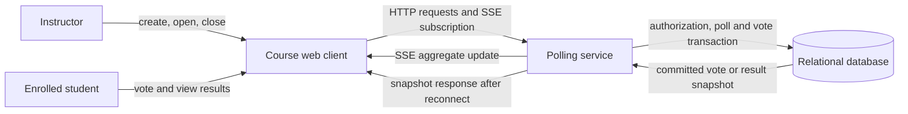
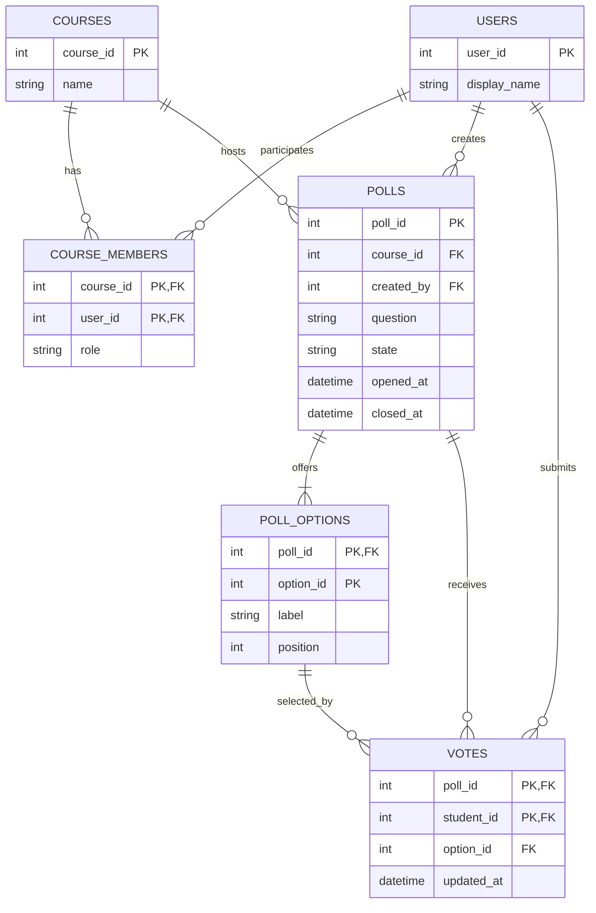

# Reference Solution — Live Classroom Polling

## 1. Clarify

Assume course identity, instructor assignments, and student enrollment already exist. Each course has at most one open poll. A student gets one current vote per poll and may change it before close. Options become immutable when the poll opens; if a correction is necessary, close the poll and create another. The vote row, not a client-side counter, is authoritative. Results are aggregate only; the initial system does not show which student selected which option to other users.

A vote is accepted only when its transaction observes the poll as open. Poll closure and vote submission serialize on the poll row (or use equivalent database isolation/conditional updates), giving a clear ordering: a vote committed before close counts; one after close is rejected. For a modest first release, use server-sent events for one-way result updates and an HTTP snapshot after reconnect. A periodic refresh fallback is reasonable if persistent connections are not supported.

## 2. Interactions

Representative endpoints:

- `POST /courses/{id}/polls` creates a draft with options for an authorized instructor.
- `POST /polls/{id}/open` and `POST /polls/{id}/close` perform state transitions.
- `PUT /polls/{id}/vote` creates or replaces the current student's answer while open.
- `GET /polls/{id}/results` returns aggregate counts after course authorization.
- `GET /polls/{id}/events` opens an SSE stream for authorized users.

On vote, the service authenticates the student, verifies enrollment and that the option belongs to the poll, locks/serializes on the poll, checks `open`, then inserts or updates the unique `(poll_id, student_id)` vote and increments the poll's result version in one transaction. It commits before notifying connected clients. Result counts are queried or derived from vote rows. A reconnecting client first establishes its event stream, then fetches a snapshot with the current version; it applies only later-version events, avoiding a gap between snapshot and subscription.

## 3. Data Model

- `users(user_id PK, display_name)` references authenticated identities.
- `courses(course_id PK, name)` is the existing course record.
- `course_members(course_id FK -> courses, user_id FK -> users, role, PK(course_id,user_id))` records student enrollment or instructor assignment. Role is constrained to student/instructor.
- `polls(poll_id PK, course_id FK -> courses, created_by FK -> users, question, state, opened_at, closed_at, created_at, version)` stores lifecycle. Enforce at most one open poll per course with a filtered unique index where supported, or lock the course row during open.
- `poll_options(poll_id FK -> polls, option_id, label, position, PK(poll_id, option_id), UNIQUE(poll_id,position), UNIQUE(poll_id,label))` stores answers. The composite primary key lets a vote reference an option only within its own poll.
- `votes(poll_id FK -> polls, student_id FK -> users, option_id FK -> poll_options, updated_at, PK(poll_id,student_id))` holds each student's current vote. A composite FK `(poll_id, option_id)` ensures the chosen option belongs to the poll.

Invariants: only the assigned instructor opens/closes or creates polls; a student must be enrolled; only open polls accept votes; a vote references an option from its own poll; unique poll/student means one current vote; close and vote serialize; counts equal grouped vote rows. Keep no separate count as canonical state.

## 4. Architecture Diagram

## 5. Database ERD

`VOTES` has one row for each poll/student pair. Its `(poll_id, option_id)` composite foreign key references the composite primary key on `POLL_OPTIONS`, so an option from a different poll cannot be selected.

## 6. Walkthrough

An enrolled student submits option 2. The service verifies enrollment, loads the poll and option, and begins a transaction that serializes on the poll row. If the poll is open and option 2 belongs to it, the service inserts or updates the student's vote row and increments the poll version. The unique key makes repeated clicks update the same current vote rather than add another voter. After commit, it computes or reads aggregate counts and publishes an update carrying that version to connected course clients. If a student's vote changes, the previous option count decreases and the new one increases because counts come from current vote rows.

An instructor closing the poll takes the same poll-row serialization point and increments the version. If closure commits first, later votes fail; if a vote commits first, it is included in final results. A reconnecting client subscribes, then fetches a current snapshot and ignores stream events at or below the snapshot version. Later events carry larger versions, so out-of-order or duplicate events cannot roll results backward.

## 7. Design Decisions

The database is authoritative for votes, poll state, and counts. A unique key gives one-vote semantics and also makes duplicate submissions naturally idempotent. Allowing vote changes is an update to one row, not an append-only vote history; if auditability is later required, record changes separately while keeping one current-vote projection.

SSE fits one-way server-to-client results; voting remains ordinary HTTP. A modest deployment can publish updates after commit in the polling service. A snapshot endpoint repairs missed events. This is simpler than a broker for an unspecified school-scale workload. Authorization is enforced on every HTTP request and stream subscription, not only in the UI.

## 8. Failure Cases & Trade-offs

- Duplicate click or retry: upsert the unique poll/student vote and return the current accepted choice.
- Vote races with close: serialize both on the poll row and define the committed order as authoritative.
- Client misses an SSE update: reconnect, fetch snapshot, and resume; never increment a local total as durable truth.
- Option belongs to a different poll: composite foreign key or equivalent transactional validation rejects it.
- Two instructors open polls simultaneously: serialize opening per course and enforce a unique-open-poll constraint.
- Update commits but process crashes before push: clients may temporarily see stale results; reconnect snapshot repairs it. A transactional outbox is justified if timely broadcast must survive process crashes.
- Public aggregate results can influence later votes. If this is a concern, hide results until close; that is a product policy, not a storage requirement.

## 9. Improvements

If multiple service instances must fan out events to clients attached to different instances, add a shared publisher or database-backed outbox only when deployment requires it. If a course has many simultaneous voters, consider short polling versus SSE based on measured connection cost and update frequency. Add anonymous mode only after defining how to enforce one response without retaining identity longer than required. Preserve a poll version or event cursor if clients need robust ordered updates.
